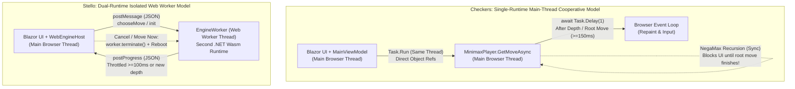

# Web Architecture Review: Checkers vs. Stello (Blazor WebAssembly)

## Executive Summary

This review compares two production .NET 10 Blazor WebAssembly board game architectures—**Checkers** and **Stello** (Othello)—that share a common heritage (MVVM architecture via `CommunityToolkit.Mvvm`, shared C# engines with desktop WPF counterparts, bitboard move generation, alpha-beta search compiled with WebAssembly AOT, and Azure Static Web Apps deployment) but take fundamentally different approaches to web execution and layout:

* **Checkers (Approach A — Single-Runtime Cooperative Multitasking)**: Runs both the Blazor UI and the AI search engine on the browser's single main thread, relying on periodic `await Task.Delay(1, cancellationToken)` calls inside the search engine to yield control back to the browser's event loop, paired with viewport-clamped (`vw`/`vh`) responsive CSS and on-screen action controls.
* **Stello (Approach B — Dual-Runtime Isolated Web Worker)**: Isolates the AI search engine and opening book inside a dedicated browser Web Worker that boots a second, independent .NET WebAssembly runtime (`dotnet.create()`), communicating via source-generated JSON over `postMessage` and `[JSExport]`/`[JSImport]`, paired with modern CSS Container Queries (`cqw`/`cqh`) and 3D staggered disc-flip animations.

### Verdict at a Glance

* **Stello wins decisively on Engine Architecture, UI Frame-Rate Stability, and Cross-Platform Separation (`IEngineHost`)**: Offloading CPU-bound minimax search to a Web Worker keeps the main thread 100% responsive at 60/120 fps and allows the engine to remain pure, synchronous, high-throughput C# without polluting core search algorithms with UI yielding hacks. Its primary drawback—terminating and rebooting the worker (`worker.terminate()`) on cancellation/Move-Now—can be solved cleanly without requiring `SharedArrayBuffer`.
* **Checkers wins on Mobile Portrait Ergonomics, Touch Action Discoverability, and Memory Footprint**: Capping the mobile board height (`65vh`) and providing dedicated on-screen action buttons (`New`, `Undo`, `Redo`), a visual scoreboard, and an active thinking progress bar makes Checkers much easier to operate on phones and tablets than Stello's desktop-only dropdown menubar. However, Checkers suffers from main-thread UI freezes during deep single-branch evaluations where synchronous `NegaMax` recursion cannot `await`.

---

## Comparative Scorecard

| Evaluation Dimension | Checkers (Single-Runtime Cooperative) | Stello (Dual-Runtime Web Worker) | Winner |
| :--- | :--- | :--- | :--- |
| **1. Responsive Design (Desktop)** | **Good** — Viewport `calc(100vw - 480px)` / `78vh` clamping works well but uses approximated offsets. | **Excellent** — CSS Container Queries (`100cqh`, `100cqw - 252px`) + JS menu alignment fit the container exactly. | **Stello** |
| **2. Responsive Design (Mobile & Touch)** | **Very Good** — `65vh` cap keeps controls above the fold; dedicated `New`/`Undo`/`Redo` buttons. HTML5 drag-and-drop fails on touch, but tap-to-move works. | **Fair** — Native `<button>` squares and keyboard focus are great, but all actions hide in top dropdown menus; mobile landscape clips side panels below the fold. | **Checkers** |
| **3. Background Processing (Engine)** | **Fair** — Single runtime saves memory, but `Task.Delay(1)` adds timer overhead on shallow plies and **cannot yield inside recursive `NegaMax`**, causing UI freezes on deep plies. | **Excellent** — True OS-thread isolation via Web Worker; zero `async` state-machine overhead in search; maximum AOT nodes-per-second (NPS). | **Stello** |
| **4. Cancellation & "Move Now"** | **Excellent** — Instant (`< 1ms`) in-memory `CancellationToken` check every 1,024 nodes; preserves Transposition Table. | **Fair** — Hard `worker.terminate()` kills the worker, wipes the 16 MB Transposition Table, and incurs a ~150–400ms worker reboot. | **Checkers** |
| **5. Frontend Updates While Thinking** | **Fair** — Has a nice indeterminate thinking bar, but `NegaMax` progress reports queue up without rendering until a root move finishes; unbatched `OnAnalysisUpdated` re-renders all 64 squares. | **Very Good** — Worker-side `ProgressPoster` throttles updates to 100ms while passing new depths/best moves immediately; main thread never drops a frame. | **Stello** |
| **6. Memory & Startup Footprint** | **Excellent** — Single .NET Wasm runtime (~30 MB heap); embedded opening book; fast local Release build conditional AOT. | **Good** — Dual .NET Wasm runtimes (~55–70 MB total heap) + duplicated opening book buffer, though Stello has a better `%` loading indicator. | **Checkers** |
| **7. Cross-Platform Architecture** | **Good** — Shares `MainViewModel`, but leaks browser UI concerns (`Task.Delay(1)`) into `Checkers.Core.MinimaxPlayer` and lacks web settings persistence. | **Excellent** — `IEngineHost` cleanly separates `LocalEngineHost` (WPF) from `WebEngineHost` (Web); full `localStorage` persistence for settings, appearance, and book. | **Stello** |

---

## 1. Responsive Design & Multi-Device Usability

### 1.1 Board Sizing: Viewport Math (Checkers) vs. CSS Container Queries (Stello)

#### Checkers (`src/Checkers.Web/wwwroot/css/app.css`)
Checkers sizes `.checkerboard-container` using viewport-relative `min()` expressions:
```css
/* Desktop (> 900px) — app.css:147-152 */
.checkerboard-container {
    width: min(calc(100vw - 480px), 78vh, 1080px);
    height: min(calc(100vw - 480px), 78vh, 1080px);
    min-width: 320px;
    min-height: 320px;
    aspect-ratio: 1 / 1;
}

/* Mobile/Tablet (<= 900px) — app.css:314-319 */
.checkerboard-container {
    width: min(92vw, 65vh, 1080px);
    height: min(92vw, 65vh, 1080px);
}
```
* **Strengths**:
  * **Mobile Portrait Ergonomics**: By capping the board at `65vh` on screens `<= 900px`, Checkers guarantees that at least `35%` of the viewport height remains available below the board. On a smartphone in portrait orientation, the player can see the board, the active turn/thinking status, the piece/king count cards, and the `New / Undo / Redo` buttons **simultaneously without scrolling**.
  * **Natural Document Scrolling**: `.app` uses `min-height: 100vh` (`app.css:19`), allowing the page to scroll naturally when content (such as Move History) exceeds the viewport height.
* **Weaknesses**:
  * `calc(100vw - 480px)` and `78vh` are magic-number approximations of the side-panel width (`280px–420px`), menubar height, and padding. Between `901px` and `960px` viewport widths, `100vw - 480px` squeezes the board more than necessary while `.side-panels` has flexible width.
  * Setting both `width` and `height` alongside `aspect-ratio: 1 / 1` and `min-width`/`min-height` is redundant and can cause aspect-ratio distortion if one axis hits a constraint before the other.

#### Stello (`Stello.Net/Stello.Web/wwwroot/css/app.css`)
Stello locks `.app` to `height: 100vh` (`app.css:18`) and turns `.content` into a **CSS Size Container**:
```css
/* app.css:99-115 */
.content {
    display: flex;
    flex: 1;
    justify-content: center;
    align-items: flex-start;
    gap: 12px;
    min-height: 0;
    padding: 12px;
    overflow: auto;
    container-type: size;
}

.board-area {
    flex: none;
    width: min(100cqh, 100cqw - 252px);
}
```
* **Strengths**:
  * **Mathematical Precision on Desktop**: Because `100cqh` and `100cqw` measure `.content`'s inner content box (after the menubar height and `12px` padding are already subtracted), and `.side-panels` has a fixed `width: 240px` plus `gap: 12px` (`252px` total), `min(100cqh, 100cqw - 252px)` makes the board fill **100% of the exact remaining space** at every desktop window size with zero magic-number approximations.
  * **Browser Compatibility**: CSS Container Queries (`container-type: size`, `cqw`, `cqh`) have been supported across all evergreen browsers (Chrome/Edge 105+, Safari 16+, Firefox 110+) since early 2023 and are completely safe for production WebAssembly apps.
  * **Dynamic Menu Alignment**: `stello.js` (`initMenuAlignment`, lines 74–116) uses a `ResizeObserver` to align the top menu bar's left padding (`--menu-left`) with the left edge of `.board-area`, creating a polished desktop layout.
* **Weaknesses & Edge Cases**:
  * **Mobile Landscape Trap (`@media (max-width: 700px)`)**: At `<= 700px` (`app.css:379-395`), Stello switches `.content` to `flex-direction: column` and sets `.board-area { width: min(100cqw, 100cqh); }`.
    * On a **phone in portrait mode**, `100cqw < 100cqh`, so the board takes full width and the status/analysis panels sit neatly below it.
    * On a **phone in landscape mode** (e.g., `667px × 375px`), the width is still `<= 700px`, so it stays in `flex-direction: column`! The board takes `100cqh` (100% of the vertical height), pushing the Status and Analysis panels completely below the fold and leaving wide empty margins on the left and right of the board.
    * On a **phone in portrait mode with a short screen**, if the board + status + analysis exceed `100cqh`, the user must scroll inside `.content` to see the analysis panel.
  * **`100vh` vs `100dvh`**: Using `height: 100vh` on `.app` (`app.css:18`) instead of `100dvh` causes mobile browsers with collapsible URL bars (iOS Safari, Android Chrome) to clip the bottom of the scroll container when the address bar is expanded.

### 1.2 Touch, Mouse, and Keyboard Ergonomics

* **Piece Movement & Accessibility**:
  * **Checkers (`src/Checkers.Web/Components/Board.razor:16-44`)**:
    * Supports both click-to-move (`@onclick`) and HTML5 Drag-and-Drop (`draggable="true"`, `@ondragstart`, `@ondragover:preventDefault`, `@ondrop`).
    * **Touch Bug**: HTML5 Drag-and-Drop events (`dragstart`/`drop`) **do not fire on mobile/tablet touchscreens** (iOS Safari, Android Chrome). Touch users must tap-to-select and tap-to-move, making the status prompt `"Click or drag a highlighted piece to move"` (`MainViewModel.cs:829`) inaccurate on touch devices. Implementing drag-and-drop across both mouse and touch requires Pointer Events (`@onpointerdown`/`@onpointermove`/`@onpointerup` with `setPointerCapture`).
    * **Keyboard Accessibility**: Checkers renders squares as `<div class="square" role="gridcell">` without `tabindex="0"` or `@onkeydown`, making the board inaccessible to keyboard-only users.
  * **Stello (`Stello.Net/Stello.Web/Components/Board.razor:15`)**:
    * Renders every square as a native `<button class="square">` with custom `:focus-visible` yellow focus rings (`app.css:189-193`) and descriptive `aria-label` attributes (`"e3, legal move"`). This provides full keyboard (`Tab` + `Enter`/`Space`) and touch-tap support out of the box.
* **Action Discoverability on Mobile/Tablet**:
  * **Checkers** places primary game controls (`New`, `Undo`, `Redo`) directly in the right-hand status panel (`Home.razor:111-115`) as large buttons, alongside a visual scoreboard (`White` vs `Black` piece and king counts) and a variant badge. However, Checkers provides **no UI button or menu item for "Move Now" or "Stop AI"**—the user can only cancel AI thinking indirectly by clicking `New` or opening a file.
  * **Stello** relies exclusively on its top desktop-style menubar (`File`, `Game`, `Moves`, `View`, `Help`) and keyboard shortcuts (`Ctrl+Z`, `Ctrl+Y`, `Ctrl+M`). On mobile and tablet devices (where physical keyboards do not exist), hiding frequent actions like `Back` (Undo), `Forward` (Redo), and `Move Now` inside top dropdown menus adds unnecessary tap friction.
* **Modal Dialog Responsiveness**:
  * **Stello** uses CSS Grid for the "About" dialog (`.dialog-with-picture { display: grid; grid-template-columns: 11rem minmax(0, 1fr); }`) and collapses it to a single column at `@media (max-width: 520px)` (`app.css:434-482`).
  * **Checkers** uses legacy `float: left; width: 140px;` for `.dialog-picture` (`app.css:586-591`) with no small-screen media query, causing narrow text wrapping beside the image on narrow phones.

---

## 2. Background Processing & Engine Execution

This is the most critical architectural comparison between the two projects.



### 2.1 Approach A: Single-Runtime Cooperative Multitasking (Checkers)

In `Checkers.App/ViewModels/MainViewModel.cs:874`, the AI is invoked via:
```csharp
var move = await Task.Run(
    async () => await ai.GetMoveAsync(Session.CurrentState, legalMoves, progress, stateHashes, token),
    token);
```
Because standard Blazor WebAssembly executes on a single browser thread, `Task.Run` does **not** offload work to a background thread—it schedules the delegate on the main thread's synchronization context. To keep the browser alive, `MinimaxPlayer.GetMoveAsync` (`src/Checkers.Core/AI/MinimaxPlayer.cs`) yields via `await Task.Delay(1, cancellationToken)` at four points:
1. Forced single-move return (`line 168`)
2. Opening book hit return (`line 196`)
3. Inside the root-move loop if `sw.ElapsedMilliseconds - lastReportMs >= 150` (`line 329`)
4. At the completion of each iterative-deepening depth `d` (`line 373`)

#### Critical Architectural Flaws Discovered in Checkers' Yielding Model
1. **Un-yielded Synchronous `NegaMax` Starves the Main Thread on Deep Plies**:
   * Inside the recursive `NegaMax` method (`MinimaxPlayer.cs:635-660`), the engine checks elapsed time every 1,024 nodes (`(NodesEvaluated & 1023) == 0`) and calls `progress.Report(...)` every `200ms` (`line 649`).
   * **However, `NegaMax` is synchronous** (it takes `in BitPosition` ref-readonly structs and `out bool aborted`, which C# does not permit in `async` methods, and making recursive alpha-beta `async` at every node would destroy performance by allocating millions of `Task` state machines).
   * Because `NegaMax` never yields to the browser event loop, **calling `progress.Report(...)` at line 649 does not actually update the DOM** while `NegaMax` is running! Instead, `Progress<T>` queues callbacks onto the synchronization context while the main thread stays 100% blocked inside `NegaMax` until the current root move (`entry` in `currentOrder`) completely finishes and returns to line 329 (`await Task.Delay(1)`).
   * **Real-World Impact**: At depth 10+, evaluating a single complex root move can take **500ms to several seconds**. During that entire window, the browser tab is frozen: menus cannot be clicked, the window cannot resize smoothly, and all queued `200ms` progress reports flush in a single burst only after the root move completes.
2. **Timer Clamping Overhead at Shallow Depths**:
   * In browsers, `await Task.Delay(1)` maps to `setTimeout(..., 1)`. Per the HTML5 specification, once nested timers reach depth 5, the browser clamps the minimum timeout to **4ms** (and >= 1,000ms if the tab is backgrounded).
   * Because Checkers awaits `Task.Delay(1)` at the end of *every* completed depth (`line 373`), searching plies 1 through 7 (which take `< 1ms` of CPU time total) pays `7 × 4ms ≈ 28ms` of artificial browser timer latency.
3. **Leakage of Browser UI Concerns into Core Engine**:
   * Embedding `await Task.Delay(1)` inside `Checkers.Core.AI.MinimaxPlayer` couples the platform-independent engine library to single-threaded Blazor UI constraints, penalizing the WPF desktop app whenever `progress != null` is supplied.

#### Strengths of Checkers' Model
* **Zero Serialization Overhead & Single Heap**: The app downloads and boots only one .NET runtime (~30 MB memory footprint) and passes `BoardState` and `SearchAnalysis` objects by reference.
* **Warm Transposition Table**: `_transpositionTable` (`MainViewModel.cs:71`) persists across the entire session.
* **Instant Graceful Cancellation**: `CancelAi()` triggers `_aiCts.Cancel()`, which is checked every 1,024 nodes (`MinimaxPlayer.cs:637`), aborting search in `< 1ms` while keeping the Transposition Table intact.

---

### 2.2 Approach B: Dual-Runtime Isolated Web Worker (Stello)

Stello's `WebEngineHost` (`Stello.Net/Stello.Web/Services/WebEngineHost.cs`) and `engine-worker.js` (`wwwroot/js/engine-worker.js`) run the engine in a dedicated Web Worker:
1. `engine-client.js` resolves the fingerprinted `_framework/dotnet.js` URL via `import.meta.resolve('../_framework/dotnet.js')` and passes it to `new Worker(url, { type: 'module' })`.
2. `engine-worker.js` imports `dotnet.js`, calls `await dotnet.create()`, binds `postProgress` via `setModuleImports`, and exports `Stello.Web.Worker.EngineWorker`.
3. `WebEngineHost` starts the worker eagerly in its constructor (`_started = StartAsync();` at `WebEngineHost.cs:35`) so the worker boots in parallel while the user views the initial board.

#### Strengths of Stello's Worker Model
* **Uncompromised UI Responsiveness**: The main Blazor UI thread never runs a single node of search. Even during multi-second midgame searches or exact endgame solves, the UI responds in `< 1ms`, disc-flip animations run at 60/120 fps, and menus/dialogs never stutter.
* **Maximum Synchronous Engine Throughput**: `SearchEngine.Search` (`Stello.Engine/SearchEngine.cs:77`) is 100% synchronous C# with zero `Task.Delay` stalls or `async` overhead, achieving full AOT native-like NPS.
* **Trim- & AOT-Safe Protocol**: `EngineProtocol.cs` uses source-generated `JsonSerializerContext` (`EngineProtocolJson`) over flat value records (`MoveRequest`, `MoveResponse`, `ProgressReport`).

#### Weaknesses & Edge Cases in Stello's Worker Model
1. **Destructive Cancellation via `worker.terminate()`**:
   * Because the worker thread is blocked inside synchronous `EngineWorker.ChooseMove`, it cannot process incoming `postMessage` events until `ChooseMove` returns.
   * Therefore, when the user triggers **Move Now** (`Ctrl+M`), **Back** (`Undo`), **Switch Sides**, or **New Game** while the computer is thinking, `WebEngineHost.ChooseMoveAsync` (`WebEngineHost.cs:76, 132-137`) calls `Restart(client)`:
     * Calls `worker.terminate()` (`engine-client.js:70`), immediately killing the OS thread.
     * Spawns a brand-new Worker, re-runs `dotnet.create()`, reallocates two `2^19`-slot transposition tables (`_midgameTable` and `_endgameTable`, 16 MB total), and re-parses the binary opening book (`OPENING.bin`).
   * **Consequences**:
     * **Transposition Table Wipe**: Every time a user uses `Move Now` or `Undo` during search, all cached hash entries from the game are destroyed.
     * **Reboot Latency**: If the user clicks `Switch Sides` or `Back` while the AI is thinking, the next AI search must wait ~150–400ms for the new worker runtime to finish booting.
     * **Fallback Move Accuracy on `Move Now`**: `EngineProtocol.MoveNowResult` (`EngineProtocol.cs:91-104`) picks `last?.BestMove ?? last?.CurrentMove` from the last throttled progress report received by the main thread—which can be up to 100ms behind the worker's actual internal state.
2. **Memory Overhead (~2x Runtime Heap)**:
   * Running two independent `.NET` WebAssembly runtimes (Main UI + Worker) duplicates the Mono/Wasm runtime heap and holds two copies of the opening book in memory (`WebEngineHost._book` byte array on the main thread + `EngineWorker.s_book` inside the worker).
3. **Unnecessary Feature Restriction (`SupportsLearning => false`)**:
   * `WebEngineHost.cs:38` disables `EvaluateBook` and `SelfPlay` in the web version (`SupportsLearning => false`), even though the Web Worker already has `SearchEngine` and `OpeningBook` loaded and is the ideal place to run background book learning!

### 2.3 Comparison with Native Wasm Multithreading (`SharedArrayBuffer` / `-pthread`)
.NET WebAssembly supports native multithreading (`<WasmEnableThreads>true</WasmEnableThreads>`), which shares a single memory heap across Web Workers using `SharedArrayBuffer`.
* **Why Stello's isolated Worker approach is pragmatic**: Native Wasm threading requires the web host to serve Cross-Origin Isolation headers (`Cross-Origin-Opener-Policy: same-origin` and `Cross-Origin-Embedder-Policy: require-corp`). While configurable on Azure Static Web Apps via `staticwebapp.config.json`, COOP/COEP breaks cross-origin iframes, certain OAuth popups, and third-party un-CORS'd assets, and `.NET` Wasm multithreading still has higher interop overhead in Blazor UI components. Stello achieves background threading **without** requiring COOP/COEP headers.

---

## 3. Frontend Updates & UI Telemetry While Thinking

### 3.1 Telemetry Pipeline & Throttling
* **Stello (`Stello.Net/Stello.Web/Worker/EngineWorker.cs:62-84`)**:
  * Uses `ProgressPoster : IProgress<SearchInfo>` inside the worker before crossing the JS boundary:
    ```csharp
    long now = _clock.ElapsedMilliseconds;
    if (info.Depth == _lastDepth && info.BestMove == _lastBest && now - _lastPostMs < 100)
    {
        return;
    }
    ```
  * **Evaluation**: This is an exemplary pattern. High-value state transitions (a new iterative-deepening `Depth` or a change in `BestMove`) are posted **immediately** with zero delay, while high-frequency node/time counter updates are throttled to at most 10 messages/second (`100ms`). This prevents `postMessage` serialization from saturating the main thread.
* **Checkers (`src/Checkers.Core/AI/MinimaxPlayer.cs:315-330, 369, 646-659`)**:
  * Throttles root-loop heartbeats to `150ms` (`line 315`) and inner `NegaMax` reports to `200ms` (`line 646`), plus depth-completion reports (`line 369`).
  * **Evaluation**: Because inner `NegaMax` reports (`line 649`) do not yield the thread, the telemetry UI only visibly updates when execution returns to the root loop (`line 329`) or finishes a depth (`line 373`). In complex positions with high branching factors, the `Time` and `Nodes` counters visibly stall and jump rather than ticking smoothly at 5–7 Hz.

### 3.2 Blazor Render Batching & Unnecessary Board Re-Renders
Both applications implement a smart render-coalescing pattern in `Home.razor` (`OnChanged`):
```csharp
private void OnChanged(object? sender, EventArgs e)
{
    if (_renderPending) return;
    _renderPending = true;
    _ = InvokeAsync(async () =>
    {
        await Task.Yield();
        _renderPending = false;
        StateHasChanged();
    });
}
```
This ensures that when `Refresh()` updates all 64 `SquareViewModel` instances in a loop, Blazor only renders once per frame rather than 64 times.

**However, both apps share a hidden rendering bottleneck during AI thinking**:
1. **In Checkers (`src/Checkers.Web/Pages/Home.razor:220, 291`)**:
   * `Vm.Analysis.Updated += OnAnalysisUpdated;` calls `private void OnAnalysisUpdated() => _ = InvokeAsync(StateHasChanged);`, which **bypasses `_renderPending`**!
   * Worse, calling `StateHasChanged()` on `Home.razor` re-renders the entire `Home` component tree—which re-executes `<Board Squares="Vm.Squares" ... />` (looping through `8 × 8 = 64` squares, computing CSS classes and ARIA labels for every square) and re-renders the `<ol>` Move History list on every single AI analysis heartbeat!
2. **In Stello (`Stello.Net/Stello.Web/Pages/Home.razor:48, 134` & `Board.razor:61-106`)**:
   * `Vm.Analysis.PropertyChanged += OnChanged;` uses `_renderPending` batching, so the 7 property updates on `AnalysisViewModel` coalesce into 1 `StateHasChanged()` call on `Home`.
   * However, because `Squares="Vm.Squares"` is a reference type (`IReadOnlyList<SquareViewModel>`), Blazor **always** re-renders child components that accept reference-type parameters when the parent (`Home`) calls `StateHasChanged()`.
   * Consequently, 10 times per second while the engine is thinking, `Board.OnParametersSet()` (`Board.razor:61-106`) runs its 64-square diff loop even though zero squares changed!
3. **Fix for Both Apps**:
   * Either isolate the `<Analysis>` panel into its own Razor component that subscribes to `Vm.Analysis` directly (so `Home` and `Board` never re-render during search telemetry), or override `ShouldRender()` / track a board state version counter on `Board.razor`.

### 3.3 Visual Thinking Indicators
* **Checkers** displays a dedicated animated progress bar (`.thinking-bar` in `Home.razor:79-84`) whenever `Vm.IsAiThinking` is true, providing clear peripheral feedback even if the user hides the `Analysis` panel.
* **Stello** updates the text in the Status panel to `"Thinking…"` (`MainViewModel.cs:434`), which is subtle and easy to miss if the `Analysis` panel is toggled off.

---

## 4. Code Sharing, Asset Lifecycle & Architecture ("Other")

### 4.1 Cross-Platform MVVM Architecture (WPF + Web)
* **Engine Host Abstraction**:
  * **Stello** defines `IEngineHost` (`Stello.App/Services/IEngineHost.cs`), with `LocalEngineHost` (`Task.Run` on a desktop thread-pool thread) for WPF and `WebEngineHost` (Web Worker) for Blazor. `Stello.App.MainViewModel` and `Stello.Engine` remain 100% platform-pure.
  * **Checkers** has `MainViewModel` instantiate `MinimaxPlayer` directly (`MainViewModel.cs:925-930`) and call `Task.Run` itself, forcing `MinimaxPlayer` to include `Task.Delay(1)` to accommodate Blazor WebAssembly.
* **Settings & State Persistence**:
  * **Stello** implements `LocalStorageSettingsStore`, `AppearanceStore`, and `LocalStorageBookStore`. User preferences (search mode, depth/time limits, board wood style, 3D pieces, flip animations, analysis visibility) and learned book moves survive page reloads.
  * **Checkers** has no settings persistence in `Checkers.Web`; reloading the page resets all settings and preferences to defaults.
* **Opening Book Architecture**:
  * **Checkers** embeds `OpeningBook.English.txt` and `OpeningBook.International.txt` as assembly `EmbeddedResource`s inside `Checkers.Core.dll` (`Checkers.Core.csproj:11`), parsed lazily via `Lazy<OpeningBook>`. This requires zero extra HTTP requests and works identically on WPF, Web, and CLI tests.
  * **Stello** copies `opening-book.bin` to `wwwroot/data/OPENING.bin` via MSBuild (`Stello.Web.csproj:28-34`) and downloads it via `HttpClient` in `Program.cs:37` before the app renders (`StartupBook.LoadAsync()`), falling back to `localStorage` if the user has added games.
    * *Edge Case*: Saving the binary book as Base64 in `localStorage` (`LocalStorageBookStore.cs:45`) works well for small-to-medium books, but browser `localStorage` is capped at ~5 MB per origin (and Base64 adds 33% overhead). `IndexedDB` is better suited if books grow large.
* **Audio Engineering**:
  * **Checkers** features an impressive zero-asset procedural WAV synthesizer (`SoundWaves.cs` + `BrowserSoundService.cs`) that generates distinct PCM waveforms in C# for `Move`, `Capture`, `King`, and `Win`, registering them as `Blob` URLs in `checkers.js:76-91` with a serialized playback queue.
  * **Stello** synthesizes an 880 Hz error beep using the browser's `AudioContext` oscillator (`stello.js:63-72`).
* **Build & AOT Configuration**:
  * Both apps compile to WebAssembly AOT in Release builds (`<RunAOTCompilation>true</RunAOTCompilation>`), which is essential for bitboard minimax engines (providing a ~5×–10× speedup over interpreted IL in WebAssembly).
  * **Checkers (`Checkers.Web.csproj:11`)** uses a smart MSBuild condition:
    `Condition="'$(Configuration)' == 'Release' and ('$(RunAOTCompilation)' == 'true' or '$(GITHUB_ACTIONS)' == 'true')"`
    This keeps local `dotnet publish -c Release` fast during development while guaranteeing AOT in CI/CD.
  * **Stello (`Stello/wwwroot/css/app.css:564, 576`)** binds its startup SVG progress ring to `--blazor-load-percentage` and `--blazor-load-percentage-text`, giving users real-time download progress for the AOT bundle, whereas Checkers only displays a static `"Loading Checkers..."` label (`Checkers/wwwroot/index.html:21`).

---

## 5. Summary of Edge Cases & Bottlenecks Discovered

### In Checkers
1. **Main-thread freeze during deep single-move search**: `MinimaxPlayer.NegaMax` (`MinimaxPlayer.cs:649`) calls `progress.Report(...)` synchronously without yielding; UI updates and user inputs stall until the current root move returns to `GetMoveAsync` (`line 329`).
2. **Artificial 4ms timer penalty per shallow ply**: Awaiting `Task.Delay(1)` after every completed iterative-deepening depth (`MinimaxPlayer.cs:373`) adds ~25–30ms of browser timer clamping delay across shallow plies 1–7.
3. **HTML5 Drag-and-Drop does not work on touchscreens**: `draggable="true"` / `@ondrop` (`Board.razor:20-21, 37-38`) is ignored by iOS Safari and Android Chrome without Pointer Events.
4. **No "Move Now" or "Stop" action**: Users cannot force the AI to move immediately or abort a long search without starting a new game.
5. **Unbatched re-rendering of all 64 squares on every analysis tick**: `OnAnalysisUpdated` (`Home.razor:291`) calls `StateHasChanged()` on `Home`, re-evaluating all 64 squares in `Board.razor` on every progress heartbeat.

### In Stello
1. **Destructive worker termination on `Move Now` / `Undo`**: `WebEngineHost.Restart` (`WebEngineHost.cs:132-137`) calls `worker.terminate()`, wiping the 16 MB Transposition Tables (`_midgameTable` and `_endgameTable`) and incurring a ~150–400ms worker cold-start penalty.
2. **Mobile Landscape layout clipping**: At `@media (max-width: 700px)` (`app.css:379-395`), switching `.content` to `flex-direction: column` with `width: min(100cqw, 100cqh)` causes landscape phones (`e.g. 667×375`) to size the board to `100%` of the viewport height and push the side panels completely off-screen below the fold.
3. **High tap friction for mobile actions**: Primary game actions (`Back`, `Forward`, `Move Now`, `New Game`) are only accessible via top dropdown menus or desktop keyboard shortcuts.
4. **64-square diff loop runs on every analysis update**: `Board.OnParametersSet()` (`Board.razor:61-106`) loops over all 64 squares whenever `Home` re-renders for an `AnalysisViewModel` property change.

---

## 6. Synthesis & Recommendations: The Ideal "Best-of-Both" Blueprint

To combine the best architectural qualities of **Checkers** and **Stello** into a reference blueprint for CPU-intensive Blazor WebAssembly games:

### 1. Adopt Stello's `IEngineHost` + Web Worker Architecture—With Non-Destructive Cooperative Cancellation
* **Use a Dedicated Web Worker (`IEngineHost`)**: Keep the core engine synchronous and isolated in a Web Worker (`Stello` style) so the main UI thread never drops frames and the core engine library remains free of `Task.Delay(1)` UI hacks.
* **Eliminate `worker.terminate()` for Normal Cancellations**:
  * Have the worker briefly yield to its own JS event loop once every `100ms` (for example, inside `ProgressPoster.Report` when it posts a progress message, or by polling a 4-byte `SharedArrayBuffer` if COOP/COEP headers are enabled, or by making only the top-level root/iterative-deepening loop in `EngineWorker` yield via `setTimeout(0)` every `100ms`).
  * This allows `{ command: 'cancel' }` or `{ command: 'moveNow' }` messages from the main thread to be processed gracefully inside the worker—preserving the **16 MB Transposition Table** and **Opening Book** in memory and returning the exact internal best move immediately, while keeping `worker.terminate()` solely as a dead-man's switch if the worker fails to respond within `300ms`.

### 2. Combine Stello's CSS Container Queries with Orientation-Aware Breakpoints & Checkers' Mobile Controls
* **Use `100dvh` and Container Queries with Aspect-Ratio Awareness**:
  * Replace `height: 100vh` with `height: 100dvh` on `.app`.
  * Instead of switching from row to column based solely on `@media (max-width: 700px)` (which breaks on landscape phones), switch based on container aspect ratio or orientation:
    ```css
    @container (max-aspect-ratio: 1/1) or (max-width: 600px) { ... }
    ```
  * When stacked vertically in portrait mode, cap the board height (`min(100cqw, 62cqh)` like Checkers' `65vh`) so the status panel and primary action buttons (`New`, `Undo`, `Redo`, `Move Now`) remain visible above the fold without scrolling.
* **Expose Primary Actions as Touch Buttons**: Keep Checkers' on-screen `New`, `Undo`, `Redo` (and add `Move Now` while thinking) buttons in the status panel for touch ergonomics, alongside Stello's `<button class="square">` board accessibility.
* **Use Pointer Events for Drag-and-Drop**: If drag-and-drop is offered (as in Checkers), implement it via `@onpointerdown` / `@onpointermove` / `@onpointerup` so it works seamlessly across mouse, stylus, and touchscreens.

### 3. Decouple `<AnalysisPanel>` Rendering from `<Board>` Rendering
* Extract the Analysis `<dl>` grid into a standalone `<AnalysisPanel Data="Vm.Analysis" />` component that subscribes to `Vm.Analysis.PropertyChanged` internally.
* In `Board.razor`, avoid re-diffing the 64 squares when only the clock or analysis text changes by passing an integer `BoardVersion` (or overriding `ShouldRender()`) so the 64-square DOM tree is only touched when a piece actually moves or selection changes.

