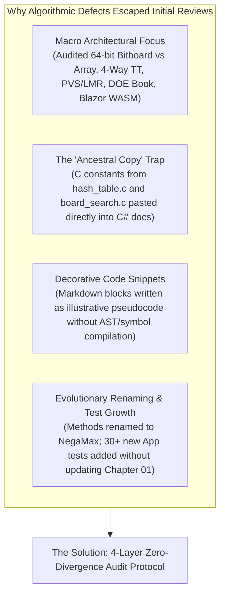
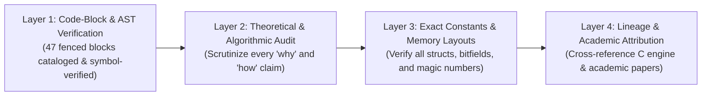
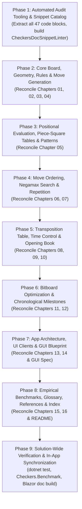

# Exhaustive Documentation, Engine Lineage & Algorithmic Audit Plan (Checkers .NET)

## Executive Summary & Mission

The Checkers technical documentation in [`docs/brain/`](../docs/brain/) and the universal architectural blueprint [`docs/general-game-gui-specification.md`](../docs/general-game-gui-specification.md) represent an extensive treatise detailing the architecture, algorithms, data structures, bitboard optimizations, and mathematical foundations of the engine. Over iterative development milestones, the engine evolved from a high-performance C# adaptation of Collin Kees's C/WebAssembly engine ([`Checkers-Engine-main`](../Checkers-Engine-main), also known as the *Marcher Engine*) into a unified, zero-allocation, 64-bit bitboard architecture supporting dual rule variants: **English Checkers** (1-step Kings) and **International Draughts** ($8 \times 8$ Flying Kings).

The engine integrates key academic and practical algorithmic breakthroughs:
- A $2\times$-scaled hardware `POPCNT` static heuristic evaluation ([`EvaluationFunction.cs`](../src/Checkers.Core/AI/EvaluationFunction.cs)) adapted 1:1 from [`board_eval.c`](../Checkers-Engine-main/src/engine/board_eval.c) for English Checkers and extended with $O(1)$ long-diagonal masks and material-gated trade bonuses for International Flying Kings.
- An allocation-free Negamax search ([`MinimaxPlayer.cs`](../src/Checkers.Core/AI/MinimaxPlayer.cs)) featuring two-stage search enhancements: **Stage A Exact Search** (Principal Variation Search `USE_PVS`, 16-bit packed Killer/History move ordering, and path-aware in-search repetition detection via [`DrawTable.cs`](../src/Checkers.Core/AI/DrawTable.cs)) and **Stage B Selective Pruning** (Reverse Futility Pruning `USE_RFP`, Futility Pruning `USE_FUTILITY`, and Two-Stage Verified Late Move Reductions `USE_VERIFIED_LMR`).
- A 4-way set-associative 64-byte CPU cache-line Transposition Table ([`TranspositionTable.cs`](../src/Checkers.Core/AI/TranspositionTable.cs)) inspired by [`hash_table.c`](../Checkers-Engine-main/src/engine/hash_table.c), packing 16-byte entries with `StaticEval` caching, Pinned Object Heap allocation, and `Sse.Prefetch0` hardware prefetching.
- Autonomous 12-ply Directed Acyclic Graph (DAG) opening books ([`OpeningBook.cs`](../src/Checkers.Core/AI/Book/OpeningBook.cs)) constructed via Thomas R. Lincke's priority-driven **Drop-Out Expansion (DOE)** algorithm (`32,369` English / `26,367` International positions).
- Official tournament rulesets from the **World Checkers/Draughts Federation (WCDF)** and the **Fédération Mondiale du Jeu de Dames (FMJD)**, including strict mandatory captures, free choice among branches, and turn-ending crown-rank promotions.

Despite rigorous initial documentation, our preliminary code-to-doc AST probe revealed subtle micro-algorithmic and ancestral copy drifts. For example:
1. **The "Capture Fast-Path" Fictitious Branch in Chapter 06:** The documentation in [`06-move-ordering.md`](../docs/brain/06-move-ordering.md) asserts that `OrderBitMoves` contains an early `if (moves[0].IsCapture)` branch that skips scoring, invokes `OrderCaptureMoves(moves)`, and performs manual insertion shifting. In the active production code ([`MinimaxPlayer.cs`](../src/Checkers.Core/AI/MinimaxPlayer.cs#L1070-L1141)), no such branch exists—`OrderBitMoves` scores captures inline using `1_000_000 + (m.CaptureCount * 10_000) + (m.IsPromotion ? 1_000 : 0)`, while `OrderCaptureMoves` is dedicated exclusively to `Quiescence`.
2. **Ancestral Macro Drift in Chapter 08:** The Transposition Table chapter lists `Exact (1), LowerBound (2), UpperBound (3)` and states bit 2 (`0x04`) is `HasStaticEval`. This was copied directly from Collin Kees's C macros in [`hash_table.c`](../Checkers-Engine-main/src/engine/hash_table.c#L12-L14) (`#define PV_NODE 1`, `LOWER_BOUND 2`, `UPPER_BOUND 3`), whereas the active C# enum in [`TranspositionTable.cs`](../src/Checkers.Core/AI/TranspositionTable.cs#L13-L23) uses standard 0-indexing (`Exact = 0, LowerBound = 1, UpperBound = 2`) with flags `OccupiedBit = 0x04`, `HasMoveBit = 0x08`, and `HasStaticEvalBit = 0x10`.
3. **Ghost Pointer `_entriesPtr` in Chapter 08:** The prefetch code snippet in [`08-transposition-table.md`](../docs/brain/08-transposition-table.md) depicts arithmetic on a nonexistent cached pointer `_entriesPtr + ((int)(key & _bucketMask) << 2)`, whereas production uses `Unsafe.Add(ref MemoryMarshal.GetArrayDataReference(_entries), ...)` with the `unsafe` keyword on `Prefetch`.
4. **Method Identifier Divergence across 6 Chapters:** Chapters 06, 07, 08, 09, 11, and 13 refer to the recursive search method as `NegamaxBitboard`, but in [`MinimaxPlayer.cs`](../src/Checkers.Core/AI/MinimaxPlayer.cs#L614) the active method is named `NegaMax`.
5. **Outdated Verification Metrics in Chapter 01:** Chapter 01 cites `123 unit tests` for Core and `40 unit tests` for App, whereas the current production test suite contains **`124` Core tests** and **`70` App tests** (`194` total passing tests).

This plan establishes an **exhaustive, statement-by-statement, snippet-by-snippet, and lineage-verified audit protocol** to eliminate all discrepancies and guarantee 100% mathematical, algorithmic, and syntactic fidelity between the documentation, the active .NET 10 production codebase, and its ancestral C/academic origins.

---

## Root Cause Analysis: Why Did Algorithmic & Micro Discrepancies Escape?

1. **Macro Architectural Focus vs. Micro Algorithmic Verification:**
   Earlier development phases focused on high-level system completions: transitioning from the legacy array engine to 64-bit bitboards, introducing the 4-way cache-line Transposition Table, building the 12-ply opening books via Drop-Out Expansion, and deploying Blazor WebAssembly AOT with Web Workers. Intermediate helper method signatures, loop variables, and internal scoring branches were assumed to be accurate.
2. **The "Ancestral Copy" Trap:**
   Because `Checkers-Engine-main` served as the foundational inspiration for bitboards, static evaluation, and search pruning, several documentation chapters directly cited or mirrored C structures (such as `PV_NODE 1` from `hash_table.c` or `upMovers` from early C prototypes) without re-checking how they were adapted into modern C# 13 / .NET 10 idioms (such as 0-indexed enums and `MemoryMarshal.GetArrayDataReference`).
3. **Snippets as Decorative Ornaments vs. Authoritative Code:**
   Code snippets inside markdown were written or adapted without running automated symbol checking, AST verification, or direct source comparisons.
4. **Absence of an Itemized Claim & Snippet Register:**
   There was no centralized registry cataloging every code block (all 47 blocks across `docs/brain/*.md` and `docs/general-game-gui-specification.md`) with an empirical binary PASS/FAIL verification against source lines.

---

## The 4-Layer Zero-Divergence Audit Framework

This audit plan executes a four-tiered verification protocol across all 16 chapters of [`docs/brain/`](../docs/brain/), [`docs/brain/README.md`](../docs/brain/README.md), and [`docs/general-game-gui-specification.md`](../docs/general-game-gui-specification.md):

### Layer 1: Code-Block & AST Verification (Cataloging All 47 Fenced Blocks)
- Every fenced code block (`csharp`, `text`, `mermaid`, `powershell`, `pdn`) across the 18 markdown files is cataloged with start/end line numbers.
- For C# snippets:
  - Every type, method, field, property, and local variable reference must exist in [`src/Checkers.Core`](../src/Checkers.Core), [`src/Checkers.App`](../src/Checkers.App), [`src/Checkers.Wpf`](../src/Checkers.Wpf), [`src/Checkers.Web`](../src/Checkers.Web), or [`tools/Checkers.Benchmark`](../tools/Checkers.Benchmark).
  - Code snippets must match production source verbatim: method visibility, `[MethodImpl(MethodImplOptions.AggressiveInlining)]`, `unsafe` keywords, variable identifiers (e.g. `ownMen` instead of `upMovers`; `BitboardMasks.NotColA` instead of bare `NotColA`), and internal branch structures.
  - Eliminate fictitious code: remove the non-existent `if (moves[0].IsCapture)` branch in Chapter 06 and align with inline scoring; remove `_entriesPtr` in Chapter 08 and align with `MemoryMarshal.GetArrayDataReference`.
- For Mermaid diagrams:
  - Verify node labels, decision diamonds, and transition arcs against the actual execution pipelines in `MinimaxPlayer`, `BitboardMoveGenerator`, `TranspositionTable`, `GameSession`, and Blazor/WPF hosts.
  - Reconcile method names in diagrams (`NegaMax` vs `NegamaxBitboard`).

### Layer 2: Theoretical & Algorithmic Assertion Audit
- Scrutinize every prose statement asserting *why* or *how* an algorithm operates:
  - **Iterative Deepening & Time Management:** Verify single-ply step (`for (int d = 1; d <= maxTargetDepth; d++)`), soft limit ($2/3$ of time for TimePerMove, dynamic piece-count formula for TimePerGame), hard limit polling latch (`(NodesEvaluated & 4095) == 0`), dominant-move early termination streak (`d >= 8`, lead $\ge 150\text{ cp}$ for 2 consecutive iterations), and partial-iteration root move adoption on timeout.
  - **Principal Variation Search (PVS):** Verify full-window root and first-move search ($i = 0$), null-window scouting bounds ($[-\alpha - 1, -\alpha]$ for $i > 0$), and two-stage fail-high re-search conditions.
  - **Selective Pruning (Stage B):** Verify Reverse Futility Pruning condition (`beta < WinThreshold`, `cachedStaticEval - RfpMargin * depth >= beta`, opponent quiet check via `!HasAnyCapture`), Futility Pruning condition (`depth <= FutilityMaxDepth`, `cachedStaticEval + FutilityMargin * depth <= alpha`), and Two-Stage Verified LMR (reduction formula $R = 1 + (i \ge 8 ? 1 : 0)$, clamped to $d - 2$, verified at full depth $d - 1$ on null window before full-window re-search).
  - **In-Search Repetition (`DrawTable`):** Verify why the repetition check *must* execute before the Transposition Table probe (`ply > 0`), active search path tracking (`_pathHashes[ply]`), and pre-root history hashing (`_twoFoldHashes`, `_oneFoldHashes`).
  - **Rules & King Flight:** Verify flying king ray-slide, long-distance jump captures, the **Mandatory Continuation Requirement** (only landing squares enabling follow-up captures are legal), and turn-ending crown-rank promotion.
  - **Drop-Out Expansion (DOE):** Verify priority function, depth-tapered dropout margins $\delta(\text{ply})$ ($15\text{ cp}$ at `lv 0..5`, $10\text{ cp}$ at `lv 6..9`, $6\text{ cp}$ at `lv 10+`), visit selection, and bottom-up Negamax score backup.

### Layer 3: Exact Constants, Magic Numbers & Memory Layouts
- Reconcile every hardcoded number, table dimension, and struct layout against source definitions:
  - **Bitboard Dimensions & Structs:** `BitPosition` = 48 bytes (`4 × ulong` piece boards + `Hash` + `HalfMoveClock` + `SideToMove`), `BitMove` = 16 bytes (`Captured` + `From` + `To` + `IsPromotion`).
  - **Transposition Table:** 16-byte packed `TranspositionEntry` (`Key32` = 4B, `Score` = 2B, `StaticEval` = 2B, `BestMove` = 2B, `Depth` = 1B, `Age` = 1B, `Flags` = 1B, `Pad` = 3B), 4-way set-associative 64-byte bucket (`BucketSize = 4`), table sizes $1\text{M} \dots 16\text{M}$ entries ($16\text{ MB} \dots 256\text{ MB}$).
  - **Bound Enums & Flags:** `TranspositionBound.Exact = 0`, `LowerBound = 1`, `UpperBound = 2`; bitmasks `BoundMask = 0x03`, `OccupiedBit = 0x04`, `HasMoveBit = 0x08`, `HasStaticEvalBit = 0x10`.
  - **Score Bounds & Margins:** `WinScore = 30_000`, `LossScore = -30_000`, `WinThreshold = 25_000`, `NoStaticEval = 32_000`, `RfpMargin = 40`, `FutilityMargin = 60`, `DominantMoveMargin = 150`.
  - **Evaluation Weights ($2\times$ scale):** `ManValue = 100`, `EnglishKingValue = 140`, `InternationalKingValue = 300`, `RightLock = +40`, `Bridge = +30`, `Triangle = +20`, `Oreo = +20`, `Dog = +10`, `SingleCornerKing = -40`. Late-game advancement threshold `totalPieces <= 12`. Simplification curve: `>6` pcs: $+20$, `6`: $+60$, `5`: $+120$, `4`: $+200$, `3`: $+300$, `2`: $+400$.
  - **Opening Book Resources:** English = `32,369` unique positions (`14,320` internal + `18,049` leaves, `1.01 MB`), International = `26,367` unique positions (`11,541` internal + `14,826` leaves, `855 KB`).

### Layer 4: Lineage & Academic Attribution Truth
- Cross-reference all historical implementations, citations, and source origins:
  - **Collin Kees (`Checkers-Engine-main` / Marcher Engine, 2023–2026):** Direct source-level lineage for:
    - 64-bit bitboard dark-square layout (`(row << 3) | col`, `DarkSquares = 0x55AA55AA55AA55AAUL`).
    - Handcrafted static evaluation in [`board_eval.c`](../Checkers-Engine-main/src/engine/board_eval.c): verify 1:1 $2\times$ centipawn scaling, PSTs, `tail_pins`, `single_corner`, runaway cones `compute_runaway_cones`, structural patterns, and `calculatePieceBonus`.
    - Transposition table in [`hash_table.c`](../Checkers-Engine-main/src/engine/hash_table.c): verify 16-byte entry layout, 4-way 64-byte bucket, `Sse.Prefetch0` / `_mm_prefetch`, and priority replacement `depth - 8 * staleness + 4 * isPV`. Clarify the evolution from Kees's `#define PV_NODE 1` to .NET's 0-indexed `TranspositionBound`.
    - In-search repetition in [`draw_table.c`](../Checkers-Engine-main/src/engine/draw_table.c) and `GAME_HISTORY` seeding: verify why repetition checks must execute before TT probing.
    - Move ordering in [`killer_table.c`](../Checkers-Engine-main/src/engine/killer_table.c): 16-bit packed moves `(from << 8) | to`, 2-slot killers, and depth-squared history.
    - Search heuristics in [`board_search.c`](../Checkers-Engine-main/src/engine/board_search.c): PVS null-window bounds, Verified LMR, RFP, FP, partial-iteration root move adoption, and dominant move cutoff.
    - Opening book in [`opening_book.c`](../Checkers-Engine-main/src/engine/opening_book.c): `10 cp` acceptable evaluation loss margin, shared TT across evaluations, and node-for-node equality verification.
  - **Martin Fierz (`Cake 1.89g` & `CheckerBoard`, 2000–2021):** Landmark $8 \times 8$ English Checkers evaluation analysis ([`Plans/Cake evaluation implementation.md`](Cake%20evaluation%20implementation.md)); clarify why `cake_eval_parametrized.c` was explored and how `board_eval.c` was selected for production.
  - **Fabien Letouzey (`Scan 3.1`, 2015–2020):** Document the Phase 6b empirical experiment ([`docs/brain/05-evaluation.md`](../docs/brain/05-evaluation.md#architecture--variant-specialization)), explaining why heavy ray-mobility loops and wing-skew popcounts from $10 \times 10$ Draughts degraded search depth by $1.19\text{ plies}$ and were superseded by $O(1)$ diagonal masks.
  - **Thomas R. Lincke (ETH Zürich, 2000/2001):** Drop-Out Expansion (DOE) theory for directed acyclic opening book construction, virtual visits, and bottom-up Negamax backup.
  - **Arthur Samuel (1959 IBM) & Jonathan Schaeffer (Chinook, 1996/2007):** Foundational Checkers AI heuristics and computational proof of $8 \times 8$ English Checkers draw.
  - **WCDF & FMJD:** Official rule specifications for English Draughts (1-step kings) and International Draughts (flying kings), standard 1–32 square notation, and PDN 3.0 standard.

---

## Tool-Assisted Verification: `CheckersDocSnippetLinter`

To make this audit automated, repeatable, and regression-proof, we establish an automated linter script ([`scratch/audit_checkers_snippets.mjs`](../scratch/audit_checkers_snippets.mjs) or [`tools/Checkers.DocAudit`](../tools/)) that performs:

1. **Fenced Code Extractor:** Parses all `.md` files in [`docs/brain/`](../docs/brain/) and [`docs/general-game-gui-specification.md`](../docs/general-game-gui-specification.md), cataloging all 47 code blocks with line ranges and languages.
2. **Obsolete Pattern & Discrepancy Scanner:** Scans for:
   - Mentions of `NegamaxBitboard` (must be updated to `NegaMax`).
   - Mentions of `_entriesPtr` or obsolete pointer math in TT prefetching.
   - Discrepant `TranspositionBound` numbering (`Exact (1)` vs `Exact = 0`).
   - Discrepant bitmask flag definitions (e.g. claiming bit 2 is `HasStaticEval`).
   - Outdated unit test totals (`123` or `40` instead of `124` Core / `70` App / `194` Total).
   - Fictitious `if (moves[0].IsCapture)` or `OrderCaptureMoves` inside `OrderBitMoves`.
   - Pseudocode variables in bitboard snippets (`upMovers` instead of `ownMen`; bare `NotColA` instead of `BitboardMasks.NotColA`).
   - Inconsistent comments in source code (e.g. `(+8 cp)` comment for `FlyingKingInnerMask` vs actual `* 6` code).
3. **Symbol & Member Cross-Check:** Verifies that all types, methods, properties, and constants referenced in prose and code blocks exist in the compiled assemblies of `Checkers.slnx`.

---

## Itemized Chapter-by-Chapter Audit Register

Below is the definitive audit specification covering all 16 chapters of `docs/brain/`, `docs/brain/README.md`, and `docs/general-game-gui-specification.md`:

| Chapter / Document | Title & Focus | Fenced Blocks | Source Files to Verify Against | Critical Audit Checkpoints |
|---|---|---|---|---|
| **README.md** | [The Checkers brain](../docs/brain/README.md) | 2 blocks (mermaid) | `Checkers.Core`, `Checkers.App`, `Checkers.Web`, `Checkers.Wpf` | Audit the "brain on one page" flowchart against active bitboard move application and terminal evaluation. Reconcile chapter index and reading paths. Verify Collin Kees `Checkers-Engine` attribution. |
| **01** | [Overview](../docs/brain/01-overview.md) | 2 blocks (mermaid) | `Checkers.slnx`, `Checkers.Core`, `Checkers.App`, `Checkers.Core.Tests`, `Checkers.App.Tests` | **Discrepancy Fix:** Update test counts from `123 Core / 40 App` to active **`124 Core / 70 App`** (194 passing). Verify project roles, .NET 10 target, Clean Architecture diagram, and the sequence diagram for the life of a move (`NegaMax`, `BitPosition.Apply`, `EvaluateGameStatus`). |
| **02** | [Board and coordinates](../docs/brain/02-board-and-coordinates.md) | 1 block (mermaid) | [`Position.cs`](../src/Checkers.Core/Models/Position.cs), [`BitPosition.cs`](../src/Checkers.Core/Bitboards/BitPosition.cs), [`BitboardMasks.cs`](../src/Checkers.Core/Bitboards/BitboardMasks.cs), [`Zobrist.cs`](../src/Checkers.Core/Engine/Zobrist.cs) | Audit coordinate conversion formulas between $(Row, Col)$, Draughts $1\dots 32$, and bitboard `sq = 0..63`. Verify dark-square parity $(Row + Col) \bmod 2 = 1$. Verify `Position`, `Piece`, and `BitPosition` class diagram. Audit incremental 64-bit Zobrist XOR updates during move application. |
| **03** | [Rules and move generation](../docs/brain/03-rules-and-move-generation.md) | 2 blocks (1 text, 1 mermaid) | [`RuleEngine.cs`](../src/Checkers.Core/Engine/RuleEngine.cs), [`BitboardMoveGenerator.cs`](../src/Checkers.Core/Bitboards/BitboardMoveGenerator.cs), [`IRuleEngine.cs`](../src/Checkers.Core/Engine/IRuleEngine.cs) | Audit movement and jump mechanics: regular men forward slides/jumps, English 1-step kings, International flying kings. Verify mathematical formula for **Mandatory Continuation Requirement** ($L^*$) against `CanKingCaptureFrom` recursion. Confirm Free Choice among captures and immediate turn-ending crown-rank promotion. |
| **04** | [Game record](../docs/brain/04-game-record.md) | 4 blocks (1 csharp, 2 mermaid, 1 pdn) | [`Move.cs`](../src/Checkers.Core/Models/Move.cs), [`GameSession.cs`](../src/Checkers.Core/Engine/GameSession.cs), [`GameRecordFormat.cs`](../src/Checkers.Core/Engine/GameRecordFormat.cs), [`BitMove.cs`](../src/Checkers.Core/Bitboards/BitMove.cs) | **Snippet Audit:** Verify `Move` record snippet (L19–30) against `Move.cs`. Correct prose claiming `BitMove` is a `readonly record struct` (it is a `readonly struct`). Audit `GameSession` state machine and Undo/Redo stack handling. Verify PDN 3.0 serialization, tag-pairs (`[Variant]`, `[TimeControlMode]`), and 40-move / threefold repetition terminal conditions. |
| **05** | [Evaluation](../docs/brain/05-evaluation.md) | 1 block (mermaid) | [`EvaluationFunction.cs`](../src/Checkers.Core/AI/EvaluationFunction.cs), [`LegacyEvaluationFunction.cs`](../src/Checkers.Core/AI/LegacyEvaluationFunction.cs), `board_eval.c` | **Major Audit:** Verify 1:1 $2\times$ scaling of `board_eval.c` for English Checkers (`Man = 100`, `King = 140`, PSTs, `tail_pins`, single-corner trap `-40`, runaway cones `ConeWhite/ConeBlack`, simplification curve, and 5 structural patterns: Right Lock, Bridge, Triangle, Oreo, Dog). Reconcile International flying king evaluation (`King = 300`, continuous advancement, long-diagonal mask `+12`, inner mask `+6`, short corners `-20`, material-gated trade bonus). Document Phase 6b Scan 3.1 experiment findings. Reconcile comment in `EvaluationFunction.cs` L72 (`+8 cp` comment vs `* 6` code). |
| **06** | [Move ordering](../docs/brain/06-move-ordering.md) | 3 blocks (1 mermaid, 2 csharp) | [`MinimaxPlayer.cs`](../src/Checkers.Core/AI/MinimaxPlayer.cs) L1070–1161, [`killer_table.c`](../Checkers-Engine-main/src/engine/killer_table.c) | **Critical Algorithmic Fix:** Audit `OrderBitMoves` snippet (L99–166). **Delete the fictitious `if (moves[0].IsCapture)` branch** and rewrite to match production `scores[i]` inline calculation (`1_000_000 + m.CaptureCount * 10_000 + (m.IsPromotion ? 1_000 : 0)`). Clarify that `OrderCaptureMoves` is used exclusively in `Quiescence`. Fix root PV promotion snippet (L84–87). Update method references from `NegamaxBitboard` to `NegaMax`. |
| **07** | [Search](../docs/brain/07-search.md) | 1 block (mermaid) | [`MinimaxPlayer.cs`](../src/Checkers.Core/AI/MinimaxPlayer.cs) L614–945, [`DrawTable.cs`](../src/Checkers.Core/AI/DrawTable.cs), `board_search.c` | **Major Search Audit:** Replace all occurrences of `NegamaxBitboard` with `NegaMax`. Reconcile Negamax recurrence formula with source code. Audit Stage A Exact Search (PVS null-window $[-\alpha-1, -\alpha]$, `DrawTable` pre-TT repetition check). Audit Stage B Selective Pruning (RFP condition and `RfpMargin = 40`, FP condition and `FutilityMargin = 60`, Two-Stage Verified LMR with reduction $R = 1 + (i \ge 8 ? 1 : 0)$ and null-window full-depth verification). Verify `Quiescence` search with stand-pat and hardware $O(1)$ `HasAnyCapture` cutoff. |
| **08** | [Transposition table](../docs/brain/08-transposition-table.md) | 3 blocks (1 text, 1 mermaid, 1 csharp) | [`TranspositionTable.cs`](../src/Checkers.Core/AI/TranspositionTable.cs), `hash_table.c` | **Critical Struct & Enum Fix:** Correct the bound flag table (L56) from ancestral C `#define` numbering (`Exact (1)`, `LowerBound (2)`, `UpperBound (3)`) to active C# enum (`Exact = 0`, `LowerBound = 1`, `UpperBound = 2`). Correct `Flags` bitmask descriptions (bit 2 is `OccupiedBit = 0x04`, bit 3 is `HasMoveBit = 0x08`, bit 4 is `HasStaticEvalBit = 0x10`). Reconcile `TranspositionEntry` 16-byte memory layout. **Rewrite `Prefetch` snippet (L107–116):** remove fictitious `_entriesPtr` and reflect production `Unsafe.Add(ref MemoryMarshal.GetArrayDataReference(_entries), ...)` with the `unsafe` keyword. |
| **09** | [Time control](../docs/brain/09-time-control.md) | 1 block (mermaid) | [`MinimaxPlayer.cs`](../src/Checkers.Core/AI/MinimaxPlayer.cs) L213–415, [`SearchLimits.cs`](../src/Checkers.Core/AI/SearchLimits.cs) | Verify the 3 time control modes: Fixed Depth, Time per Move, Time per Game. Audit soft time budget ($2/3$ of hard limit for move mode; dynamic piece-count formula for game mode) and hard time limit countdown latch (`(NodesEvaluated & 4095) == 0`). Audit dominant-move early termination (`d >= 8`, lead $\ge 150\text{ cp}$ for 2 consecutive iterations) and partial-iteration root move adoption. Update `NegamaxBitboard` to `NegaMax`. |
| **10** | [Opening book](../docs/brain/10-opening-book.md) | 5 blocks (2 mermaid, 1 text, 2 powershell) | [`OpeningBook.cs`](../src/Checkers.Core/AI/Book/OpeningBook.cs), [`BookBuilder.cs`](../src/Checkers.Core/AI/Book/BookBuilder.cs), [`BookFile.cs`](../src/Checkers.Core/AI/Book/BookFile.cs), [`BookCommands.cs`](../tools/Checkers.Benchmark/BookCommands.cs) | Verify the 3 stages of innovation: Stage 1 ($k=3$ to `lv 8`), Stage 2 (Full-Width `lv 0..3`), Stage 3 (Drop-Out Expansion to `lv 12`). Verify exact position counts: English = `32,369` (`14,320` internal + `18,049` leaves, `1.01 MB`), International = `26,367` (`11,541` internal + `14,826` leaves, `855 KB`). Audit Single-Search Multi-PV (`MinimaxPlayer.SearchMultiPv`), depth-tapered dropout margins $\delta(\text{ply})$ (`15/10/6 cp`), virtual visit tracking, and bottom-up Negamax `BackUp`. |
| **11** | [Bitboards](../docs/brain/11-bitboards.md) | 4 blocks (1 text, 1 csharp, 2 mermaid) | [`BitboardMasks.cs`](../src/Checkers.Core/Bitboards/BitboardMasks.cs), [`BitboardMoveGenerator.cs`](../src/Checkers.Core/Bitboards/BitboardMoveGenerator.cs), [`BitPosition.cs`](../src/Checkers.Core/Bitboards/BitPosition.cs) | **Snippet & Identifier Audit:** Update snippet L77–82 to use production identifiers (`ownMen` instead of `upMovers`; `BitboardMasks.NotColA` instead of bare `NotColA`). Replace `NegamaxBitboard` with `NegaMax`. Audit $O(1)$ set-wise `HasAnyCapture` and `HasAnyLegalMove` broadword shift formulas. Verify precomputed diagonal ray masks, forward promotion cones `ConeWhite/ConeBlack`, and zero-allocation copy-make state transitions. |
| **12** | [Engine improvements during development](../docs/brain/12-engine-improvements.md) | 2 blocks (1 mermaid, 1 powershell) | [`Checkers.Benchmark`](../tools/Checkers.Benchmark), [`BenchmarkSuite.cs`](../src/Checkers.Core/AI/Benchmark/BenchmarkSuite.cs), JSON benchmark logs | Reconcile all 9 chronological milestones: Milestone 1 (Bitboards), Milestone 2 (TT Scaling), Milestone 3 (Phase 1 Speed), Milestone 4 (Phase 2 TT Buckets & Prefetch), Milestone 5 (Phase 3 Exact Search A: PVS, Killers, History, DrawTable), Milestone 6 (Phase 4 Selective Pruning B: LMR, RFP, FP), Milestone 7 (Phase 5 Root Adoption & Dominant Exit), Milestone 8 (Phase 6 Evaluation Overhaul & 200-Game Verification), Milestone 9 (Phase 7 12-Ply Opening Book). Verify empirical node reduction and Elo tables against JSON records. |
| **13** | [App integration](../docs/brain/13-app-integration.md) | 2 blocks (mermaid) | [`MainViewModel.cs`](../src/Checkers.App/ViewModels/MainViewModel.cs), [`LocalEngineHost.cs`](../src/Checkers.App/Services/LocalEngineHost.cs), [`WebEngineHost.cs`](../src/Checkers.Web/Services/WebEngineHost.cs), [`EngineWorker.cs`](../src/Checkers.Web/Worker/EngineWorker.cs) | Update sequence diagram from `NegamaxBitboard` to `NegaMax`. Audit Clean MVVM boundaries (`CommunityToolkit.Mvvm`). Verify desktop background `Task.Run` execution vs. Blazor WebAssembly Web Worker (`EngineWorker.js` / `WebEngineHost.cs`) and cooperative macrotask yielding. Audit live telemetry streaming (`SearchAnalysis`). |
| **14** | [GUI and settings](../docs/brain/14-gui-and-settings.md) | 4 blocks (2 mermaid, 2 text) | [`MainWindow.xaml`](../src/Checkers.Wpf/MainWindow.xaml), [`SettingsWindow.xaml`](../src/Checkers.Wpf/Views/SettingsWindow.xaml), [`Board.razor`](../src/Checkers.Web/Components/Board.razor), [`DialogHost.razor`](../src/Checkers.Web/Components/DialogHost.razor), [`SettingsViewModel.cs`](../src/Checkers.App/ViewModels/SettingsViewModel.cs) | Audit UI layout specifications: responsive desktop two-column (>768px) vs. mobile drawer stacked view (<=768px). Verify Settings dialog options: Variant (English / International), AI Engine (Minimax / Random), Time Control modes, and Opening Book toggle. Verify match integrity tracking (red status `#E74C3C` on state modification) and keyboard shortcuts. |
| **15** | [Glossary](../docs/brain/15-glossary.md) | 0 blocks | Terminology & concepts across Checkers .NET | Audit all technical definitions for complete accuracy: Bitboards, Broadword shifts, Copy-Make, Draughts notation ($1\dots 32$), Drop-Out Expansion (DOE), DrawTable, Flying King, Futility Pruning (FP), History Heuristic, Killer Moves, Late Move Reductions (LMR), Mandatory Continuation, Negamax, PVS, Quiescence, Reverse Futility Pruning (RFP), Transposition Table, Zobrist Hashing. Ensure 0 obsolete terms remain. |
| **16** | [References](../docs/brain/16-references.md) | 0 blocks | Academic citations & source repositories | Audit all academic and engine citations: Collin Kees (`Checkers-Engine` Marcher Engine), Martin Fierz (`Cake 1.89g`), Fabien Letouzey (`Scan 3.1`), Thomas R. Lincke (DOE), Arthur Samuel (1959), Donald Knuth & Ronald Moore (1975), Albert Zobrist (1970), Slate & Atkin (1977), Marsland & Reinefeld (1983), Jonathan Schaeffer (1989, 1996, 2007 Chinook), Ernst A. Heinz (1998), Romstad/Costalba/Kiiski (Stockfish), WCDF rules, FMJD rules, and .NET 10 hardware intrinsics. |
| **GUI-Spec** | [General Game GUI Blueprint](../docs/general-game-gui-specification.md) | 10 blocks (5 mermaid, 5 text) | `Checkers.App`, `Checkers.Web`, `Checkers.Wpf`, `Gomoku.App` | Cross-check universal two-player board game GUI blueprint against active Checkers implementation. Verify component contracts, dual-card scoreboard, match integrity indicator, AI background execution, and responsive breakpoints. |

---

## Phased Execution Strategy

### Phase 1: Automated Audit Tooling & Snippet Catalog
1. Develop the automated linter script ([`scratch/audit_checkers_snippets.mjs`](../scratch/audit_checkers_snippets.mjs)) to extract and catalog all 47 fenced code blocks across `docs/brain/*.md` and `docs/general-game-gui-specification.md`.
2. Generate an automated discrepancy report highlighting obsolete keywords (`NegamaxBitboard`, `_entriesPtr`, `PV_NODE 1`, `Exact (1)`, `upMovers`, outdated test counts).
3. Establish a baseline tracking inventory sheet for all 18 files.

### Phase 2: Core Board, Geometry, Rules & Move Generation (Chapters 01, 02, 03, 04)
1. **Chapter 01 (Overview):**
   - Update unit test metrics from `123 Core / 40 App` to **`124 Core / 70 App`** (194 passing).
   - Reconcile Clean Architecture diagram and life-of-a-move sequence diagram (`NegaMax`, `BitPosition.Apply`).
2. **Chapter 02 (Board & Coordinates):**
   - Verify coordinate conversions: $(Row, Col) \leftrightarrow 1\dots 32 \leftrightarrow \text{sq } 0..63$.
   - Audit class diagram against `Position`, `Piece`, and `BitPosition` structs.
   - Audit incremental Zobrist XOR hashing mechanics.
3. **Chapter 03 (Rules & Move Generation):**
   - Audit regular men forward moves/jumps and English 1-step king mechanics.
   - Verify Flying King rules and the mathematical proof of the **Mandatory Continuation Requirement** ($L^*$).
   - Verify Free Choice among multiple captures and turn-ending crown-rank promotion.
4. **Chapter 04 (Game Record):**
   - Audit `Move` record snippet line-by-line against [`Move.cs`](../src/Checkers.Core/Models/Move.cs).
   - Correct text stating `BitMove` is a `readonly record struct` (it is a `readonly struct`).
   - Audit PDN 3.0 serialization and `GameSession` Undo/Redo state machine.

### Phase 3: Positional Evaluation, Piece-Square Tables & Classical Patterns (Chapter 05)
1. **English Evaluation (1:1 with `board_eval.c` at $2\times$ scale):**
   - Reconcile every weight: Man (`100`), English King (`140`), PST bitmasks (`WhiteManPst1/2/3Mask`, `BlackManPst1/2/3Mask`, `EnglishKingPst4/5Mask`), late advancement `totalPieces <= 12`, precomputed runaway promotion cones (`ConeWhite/ConeBlack`), tail pins (`+10`), trapped single-corner king (`-40`), simplification bonus (`calculatePieceBonus`), and 5 structural formations (Right Lock `+40`, Bridge `+30`, Triangle `+20`, Oreo `+20`, Dog `+10`).
2. **International Evaluation (Flying Kings Adaptation):**
   - Reconcile Flying King material (`300`), continuous advancement (`+5` to `+6`), main long-diagonal mask (`+12`), inner ring mask (`+6`), short-corner penalty (`-20`), and material-gated trade bonus (`>= 80 cp`).
   - Reconcile source comment in [`EvaluationFunction.cs`](../src/Checkers.Core/AI/EvaluationFunction.cs#L72) (`(+8 cp)` comment vs `* 6` code).
3. **Empirical Lineage Documentation:**
   - Review and preserve the documented Phase 6b Scan 3.1 experiment notes.

### Phase 4: Move Ordering, Negamax Search & Repetition (Chapters 06, 07)
1. **Chapter 06 (Move Ordering):**
   - **Critical Fix:** Remove the fictitious `if (moves[0].IsCapture)` branch in `OrderBitMoves` snippet (lines 112–130) and align verbatim with production `scores[i]` inline scoring.
   - Clarify that `OrderCaptureMoves` is a private static helper used exclusively in `Quiescence`.
   - Update method references from `NegamaxBitboard` to `NegaMax`.
   - Verify root PV promotion logic.
2. **Chapter 07 (Search):**
   - Replace all occurrences of `NegamaxBitboard` with `NegaMax`.
   - Audit Negamax recurrence formula against production code.
   - Verify Stage A Exact Search: PVS null-window search $[-\alpha-1, -\alpha]$ and `DrawTable` repetition checks before TT probing.
   - Verify Stage B Selective Pruning: RFP (`RfpMargin = 40`), FP (`FutilityMargin = 60`), and Two-Stage Verified LMR (reduction formula, null-window full-depth verification).
   - Verify `Quiescence` search with stand-pat evaluation and $O(1)$ `HasAnyCapture` shortcut.

### Phase 5: Transposition Table, Time Control & Opening Book (Chapters 08, 09, 10)
1. **Chapter 08 (Transposition Table):**
   - **Critical Fix:** Correct bound flag table (line 56) from ancestral C `#define` numbering (`Exact (1)`, `LowerBound (2)`, `UpperBound (3)`) to active C# enum (`Exact = 0`, `LowerBound = 1`, `UpperBound = 2`).
   - Correct flag bit definitions: bit 2 is `OccupiedBit = 0x04`, bit 3 is `HasMoveBit = 0x08`, bit 4 is `HasStaticEvalBit = 0x10`.
   - **Rewrite Prefetch Snippet:** Remove fictitious `_entriesPtr` and reflect production `Unsafe.Add(ref MemoryMarshal.GetArrayDataReference(_entries), ...)` with the `unsafe` keyword.
   - Reconcile 16-byte `TranspositionEntry` struct layout and 4-way 64-byte bucket.
2. **Chapter 09 (Time Control):**
   - Verify Fixed Depth, Time per Move, and Time per Game limit formulas.
   - Audit soft limit ($2/3$ or dynamic formula), hard limit countdown latch (`(NodesEvaluated & 4095) == 0`), dominant-move early termination, and partial-iteration root move adoption.
   - Update `NegamaxBitboard` to `NegaMax`.
3. **Chapter 10 (Opening Book):**
   - Verify 3 stages of innovation (Stage 1 Top-Down, Stage 2 Full-Width `lv 0..3`, Stage 3 Drop-Out Expansion to `lv 12`).
   - Reconcile exact position counts: English = `32,369`, International = `26,367`.
   - Verify Single-Search Multi-PV (`SearchMultiPv`), depth-tapered dropout margins $\delta(\text{ply})$ (`15/10/6 cp`), virtual visit tracking, and bottom-up Negamax `BackUp`.

### Phase 6: Bitboard Optimization & Chronological Milestones (Chapters 11, 12)
1. **Chapter 11 (Bitboards):**
   - Update snippet L77–82 to use production identifiers (`ownMen` instead of `upMovers`; `BitboardMasks.NotColA` instead of bare `NotColA`).
   - Replace `NegamaxBitboard` with `NegaMax`.
   - Audit $O(1)$ broadword shift formulas for `HasAnyCapture` and `HasAnyLegalMove`.
   - Verify diagonal ray masks, promotion cones `ConeWhite/ConeBlack`, and zero-allocation copy-make state transitions.
2. **Chapter 12 (Engine Improvements During Development):**
   - Reconcile all 9 chronological development milestones against active code and JSON benchmark result files (`bitboard_benchmark_results.json`, `tt_benchmark_results.json`, `eval_match_results_english.json`, etc.).
   - Verify throughput claims: 32M–37M nodes/sec in fixed-depth search.

### Phase 7: Application Layer, GUI Architecture & Blueprint (Chapters 13, 14 & GUI Spec)
1. **Chapter 13 (App Integration):**
   - Update sequence diagram to use `NegaMax`.
   - Audit Clean MVVM boundaries (`CommunityToolkit.Mvvm`).
   - Verify desktop ThreadPool background execution vs. Blazor WebAssembly Web Worker (`EngineWorker.js`) and cooperative macrotask yielding.
   - Audit real-time search telemetry streaming (`SearchAnalysis`).
2. **Chapter 14 (GUI and Settings):**
   - Audit UI layout specifications: responsive desktop two-column (>768px) vs. mobile drawer stacked view (<=768px).
   - Verify Settings dialog options: Variant, AI Engine, Time Control modes, Opening Book toggle.
   - Verify match integrity tracking (crimson status `#E74C3C` on modification) and keyboard shortcuts.
3. **General Game GUI Specification (`docs/general-game-gui-specification.md`):**
   - Cross-check the universal turn-based board game GUI specification against Checkers implementation details.

### Phase 8: Empirical Benchmarks, Glossary, References & Index (Chapters 15, 16 & README)
1. **Chapter 15 (Glossary):**
   - Audit all technical definitions for complete accuracy; eliminate any obsolete names or descriptions.
2. **Chapter 16 (References):**
   - Verify all academic citations and ancestral repositories: Collin Kees (`Checkers-Engine`), Martin Fierz (`Cake 1.89g`), Fabien Letouzey (`Scan 3.1`), Thomas R. Lincke, Arthur Samuel, Donald Knuth, Albert Zobrist, Slate & Atkin, Marsland & Reinefeld, Jonathan Schaeffer, WCDF, FMJD.
3. **README.md:**
   - Verify master index, chapter summaries, and "brain on one page" flowchart.

### Phase 9: Solution-Wide Verification & In-App Synchronization
1. Run automated test suite: `dotnet test` (verifying all 194 unit tests pass: 124 in Core, 70 in App).
2. Run benchmark CLI verification: `dotnet run --project tools/Checkers.Benchmark -- book verify` and transposition table benchmark.
3. Run automated snippet linter: `node scratch/audit_checkers_snippets.mjs` (verifying 0 obsolete patterns and 100% symbol match).
4. Run solution build: `dotnet build` (automatically synchronizing `docs/brain/**` into `src/Checkers.Web/wwwroot/content/brain/` via `CopyBrainDocs`).
5. Verify in-app documentation reader (`/docs`) in the browser.

---

## Verification & Acceptance Checklist

- [ ] **Automated Snippet Linter Passes:** Zero undetected obsolete patterns (`NegamaxBitboard`, `_entriesPtr`, `PV_NODE 1`, `Exact (1)`, `upMovers`, outdated test counts) across all 18 markdown files.
- [ ] **Exact Algorithmic Parity:** Every loop header, bound check, struct layout, and method signature in docs matches active C# source verbatim (e.g. `OrderBitMoves` capture handling, `Prefetch`, `TranspositionBound`).
- [ ] **Ancestral Lineage Fidelity:** Precise, academically honest attribution and comparative analysis documented for Collin Kees's C engine, Martin Fierz's Cake, Fabien Letouzey's Scan 3.1, Thomas Lincke's DOE, and WCDF/FMJD rulesets.
- [ ] **Zero Regression in Test Suite:** `dotnet test` completes with 194 passing tests (124 in `Checkers.Core.Tests`, 70 in `Checkers.App.Tests`), 0 failures, 0 skipped.
- [ ] **Clean Compilation:** `dotnet build` succeeds with 0 warnings, 0 errors.
- [ ] **In-App Docs Synchronization:** All updated chapters render cleanly in the Blazor `/docs` viewer with responsive navigation, KaTeX math, and Mermaid diagrams.
- [ ] **User Control of Commits:** No git commits or pushes executed by the assistant; all staged/unstaged changes ready for user inspection and commit.

