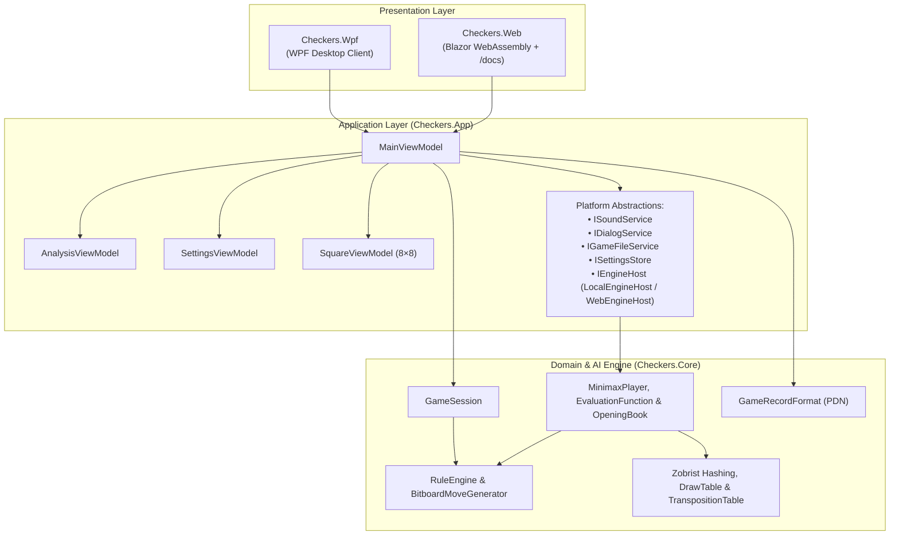
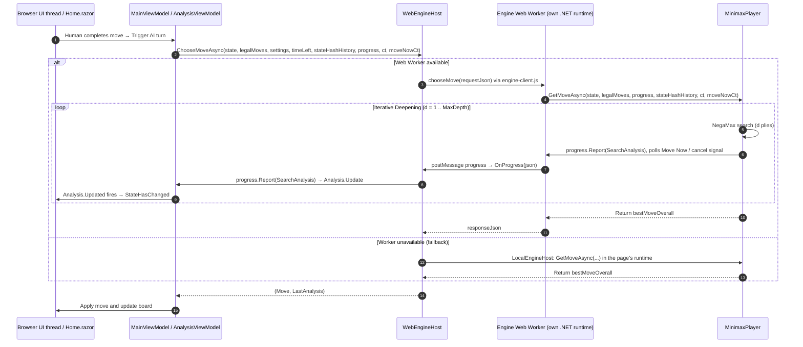

# 13 – App integration

[Back to the index](README.md)

## In short

The solution achieves strict separation of concerns by placing all game rules, bitboards, and AI search logic in `Checkers.Core`, while user interface state coordination and view models reside in the shared `Checkers.App` library.

Two client applications consume `Checkers.App`:
1. **`Checkers.Wpf`:** Native Windows desktop client targeting `.NET 10` (`net10.0-windows`).
2. **`Checkers.Web`:** Responsive Blazor WebAssembly client compiled Ahead-Of-Time (AOT) to WebAssembly and hosted statically (e.g., Azure Static Web Apps).

---

## Architectural layers

---

## Shared ViewModels (`Checkers.App`)

### `MainViewModel`
[`MainViewModel.cs`](../../src/Checkers.App/ViewModels/MainViewModel.cs) is the central coordinator for interactive gameplay:
* **Board State Synchronization:** Maintains an $8 \times 8$ array and observable `BoardSquares` collection of `SquareViewModel` instances bound to XAML/Razor templates.
* **Game Modes & Sides:** Supports **vs Computer (White)** (`HumanVsComputer` — human plays White), **vs Computer (Black)** (`ComputerVsHuman` — human plays Black with automatic board flip), **vs Human (Two players)** (`HumanVsHuman`), and `ComputerVsComputer`. Manages mid-game side switching (`SwitchSidesCommand`) and fair-play tracking (`IsStatusModified`).
* **Selection, Drag-and-Drop & Mandatory Capture Highlighting:** Intercepts square clicks and drag-and-drop gestures, computes legal destination squares, highlights pieces with mandatory captures, and executes legal moves.
* **Persistent Transposition Table & Game History Lifecycle:** Retains a single `TranspositionTable` instance across moves within a match (calling `NewSearch()` to increment the 8-bit generation age), passes `Session.StateHistory` Zobrist hashes into `GetMoveAsync` for `DrawTable` repetition detection, and clears/resizes the table when starting a new game or changing table capacity in Settings.
* **Undo/Redo & Clocks:** Coordinates linear Undo/Redo stacks, marks matches as modified when taking back moves vs. the computer, and refunds elapsed chess clock time (`_timeLeftAtPly`) to both players in `TimePerGame` mode ([Chapter 09](09-time-control.md)).

### `AnalysisViewModel`
[`AnalysisViewModel.cs`](../../src/Checkers.App/ViewModels/AnalysisViewModel.cs) binds the real-time search telemetry panel:
* Observable properties: `Move`, `Depth` (including `Book (12 plies)` on opening book hits), `Score`, `BestMove`, `Nodes` (`0 (Book)` on book hits), `Speed`, `Time`.
* **`Updated` Event:** Raises `public event Action? Updated;` whenever a new `SearchAnalysis` snapshot arrives so Blazor components can trigger `InvokeAsync(StateHasChanged)`.

### `SettingsViewModel`
[`SettingsViewModel.cs`](../../src/Checkers.App/ViewModels/SettingsViewModel.cs) backs the **Game -> Settings...** modal dialog:
* Rule variant selection: **International Draughts (Flying Kings)** vs. **English Checkers (1-Step Kings)**.
* Time control mode & sliders: **Fixed Depth** ($1\text{–}20$), **Time per Move** ($1\text{–}60\text{ s}$), and **Time per Game** ($1\text{–}60\text{ min}$).
* Transposition Table size selector: **$1{,}048{,}576$ ($16\text{ MiB}$)** up to **$16{,}777{,}216$ ($256\text{ MiB}$)** entries.
* Opening Book toggle (`UseOpeningBook`): Enables or disables the embedded 12-ply opening book (`true` by default).

---

## Presentation layer comparison

| Feature | WPF Desktop (`Checkers.Wpf`) | Blazor WebAssembly (`Checkers.Web`) |
|---|---|---|
| **Runtime Model** | Multi-threaded CLR (`.NET 10`) | WebAssembly (`.NET 10` AOT): the page and an engine Web Worker each run their own .NET runtime |
| **AI Search Execution** | Background ThreadPool (`Task.Run`) | Engine Web Worker (`engine-worker.js` + `EngineWorker.ChooseMove`); `Task.Run` fallback when no worker is available |
| **Telemetry Marshaling** | `Dispatcher` via `Progress<SearchAnalysis>` | `BrowserSynchronizationContext` + `Analysis.Updated` |
| **File Save / Load** | Native `OpenFileDialog` / `SaveFileDialog` | Browser File API & Blob downloads (GameShell's `gameShell.openTextFile` / `gameShell.downloadTextFile` in `gameshell.js`) |
| **Audio Synthesis** | Procedural PCM wave synthesis (`SoundService`) | Web Audio / HTML5 audio interop (`checkers.playSound`) |
| **Documentation Viewer** | Links to documentation | Integrated `/docs` route (GameShell's `DocsViewer` and `BrainDocs` + Markdig + KaTeX + Mermaid) |

---

## Desktop ThreadPool vs. WebAssembly Web Worker

### Desktop WPF
In WPF, UI rendering runs on the main STA thread while `Task.Run` executes `MinimaxPlayer.GetMoveAsync` on a background ThreadPool worker. `Progress<SearchAnalysis>` automatically marshals callbacks onto the WPF `Dispatcher`, keeping animations and telemetry updates smooth at 60 FPS.

### Blazor WebAssembly
In WebAssembly, the page's C# code shares the browser's UI thread with the DOM renderer, so a search on that thread would freeze the page. `WebEngineHost` therefore runs the search in an engine Web Worker:
* The worker (`engine-worker.js`) starts its own .NET runtime and calls `EngineWorker.ChooseMove`, which runs `MinimaxPlayer.GetMoveAsync` synchronously inside the worker. The page stays free to render.
* `MinimaxPlayer` reports a `SearchAnalysis` about every $100\text{ ms}$. The worker's `ProgressPoster` sends it to the page with `postMessage` (at most every $100\text{ ms}$ unless the depth or best move changed), and `WebEngineHost.OnProgress` passes it to `AnalysisViewModel`, which triggers `StateHasChanged()`.
* Move Now and cancel are written to a `SharedArrayBuffer` (1 = Move Now, 2 = cancel). `ProgressPoster` polls it on each report and cancels the matching token. If the worker does not stop within $300\text{ ms}$, or shared memory is not available, the page restarts the worker and plays the best move from the last analysis.
* If the worker cannot start, `WebEngineHost` falls back to `LocalEngineHost` (`Task.Run` on the page's runtime).

---

## Integrated Documentation Pipeline (`BrainDocs`)

In `Checkers.Web`, the contents of `docs/brain/` (including Markdown chapters and `images/*.svg` diagrams) are copied into `wwwroot/content/brain/` during build (`CopyBrainDocs` target in `Checkers.Web.csproj`) and rendered dynamically at `/docs` ([`Docs.razor`](../../src/Checkers.Web/Pages/Docs.razor) routes to the shared [GameShell](https://github.com/cjp-dev/GameShell) viewer, registered with `AddBrainDocs` in `Program.cs`):
1. **Chapter Discovery:** [`BrainDocs.cs`](https://github.com/cjp-dev/GameShell/blob/main/src/GameShell/Docs/BrainDocs.cs) parses `README.md` and extracts all links to chapter files (`05-evaluation.md`, or appendices such as `appendix-a-....md`) to build the ordered sidebar Table of Contents and Previous/Next chapter navigation.
2. **Markdown to HTML:** Markdig (`UseAutoIdentifiers(AutoIdentifierOptions.GitHub)` + `UseAdvancedExtensions()`) compiles Markdown tables, code blocks, math spans (`$...$`, `$$...$$`), and `mermaid` fenced blocks into semantic HTML and rewrites relative image and chapter URLs.
3. **Client-Side Math & Diagrams:** [`docs.js`](https://github.com/cjp-dev/GameShell/blob/main/src/GameShell/wwwroot/docs.js) lazy-loads **KaTeX** to typeset LaTeX equations and **Mermaid.js** to render architectural flowcharts, sequence diagrams, and state machines.

---

Previous: [12 Engine improvements during development](12-engine-improvements.md) · Next: [14 GUI and settings](14-gui-and-settings.md)

