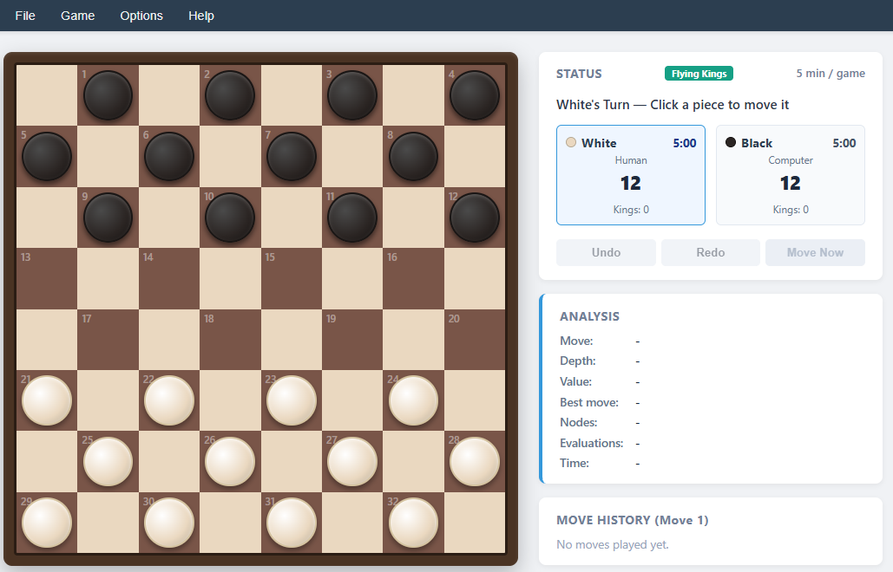
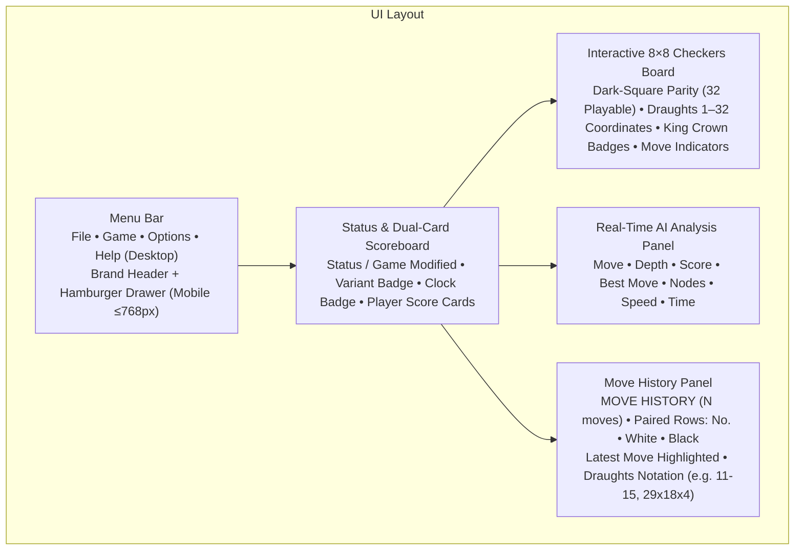
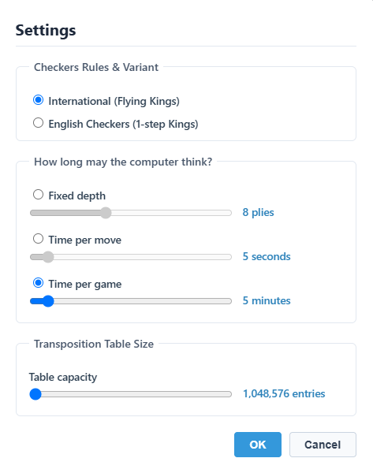
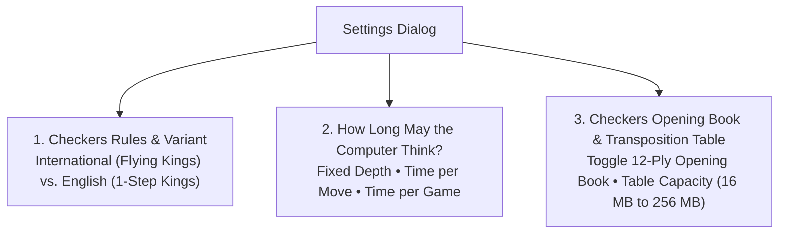

# 14 – GUI and settings

[Back to the index](README.md)

## In short

Checkers .NET features a unified, modern user interface across both **WPF desktop** (`Checkers.Wpf`) and **Blazor WebAssembly** (`Checkers.Web`) clients. Designed with a clean light theme, warm parchment aesthetic, dark walnut and maple board styling (the web version also offers Golden Oak and Reddish Wood board styles), dual-card scoreboard, and responsive SVG vector graphics, the application provides intuitive controls for casual players while exposing tournament-grade engine configuration, real-time AI search analysis telemetry, and dynamic status indicators.

This chapter documents the visual layout, responsive mobile drawer navigation, menu commands, dual-card scoreboard with chess clocks, dynamic status indicators (including the "Modified Game" alert), Game Settings configuration, the live search telemetry engine, and keyboard shortcuts.

---

## Graphical User Interface layout





### Modern Light Theme & Color Palette

Both clients share a consistent palette designed for high contrast, warm wood tones, and visual clarity:

| UI Element | Color Value | Description |
|---|---|---|
| **App Background** | `#F4F1EA` / `#F5F7FA` | Warm parchment background providing high contrast without eye strain |
| **Card & Panel Background** | `#FFFFFF` | Elevated card surfaces with soft ambient drop shadows |
| **Dark Playable Squares** | `#795548` / `#5D4037` | Rich mahogany/walnut wood texture for the 32 playable dark squares |
| **Light Inactive Squares** | `#EFEBE9` / `#D7CCC8` | Natural maple/ash wood texture for inactive light squares |
| **Board Border & Bevel** | `#3E2723` / `#4E342E` | Deep walnut wood border with coordinate lettering and numbering |
| **White Pieces** | `#DDD5C7` / `#B5A995` | Ivory draughts pieces with radial gradient shading and gold crown badges |
| **Black Pieces** | `#2B2B2B` / `#181818` | Obsidian draughts pieces with radial gradient shading and gold crown badges |
| **Active Turn Highlight** | `#3498DB` | Sky-blue ring and elevated border highlighting the player to move |
| **Primary Typography** | `#2C3E50` / `#333333` | Deep slate gray text ensuring high readability |
| **Variant Badge (International)** | `#16A085` | Teal pill badge indicating International Draughts (Flying Kings) |
| **Variant Badge (English)** | `#2C3E50` | Slate navy pill badge indicating English Checkers (1-step Kings) |
| **Modified Game Status** | `#E74C3C` | Crimson red alert header indicating the match state has been modified |
| **Move Selection / Target** | `#F39C12` / `#2ECC71` | Amber selection glow and emerald target dots for legal landing squares |

### Responsive Layout & Mobile Navigation Drawer

On desktop displays (wider than $900\text{ px}$, or $601\text{–}900\text{ px}$ in landscape), the application shows a persistent horizontal menu bar and a centred two-column layout with the $8 \times 8$ board on the left and stacked information panels on the right; the menu bar lines up with the board's left edge.

On mobile devices and narrow screens ($\le 768\text{px}$):
1. **Mobile Header & Hamburger Toggle:** The horizontal menu bar transforms into a compact header displaying the **Checkers** brand title and a hamburger button (`☰`).
2. **Slide-Out Drawer:** Tapping the hamburger button opens a modal slide-out navigation drawer from the right with an overlay backdrop. The drawer organizes commands into grouped sections (**File**, **Game**, **Options**, **Help**) with large touch targets ($44\text{ px}$ minimum height), clear selection indicators (`●` for active game mode, `✓` for active toggles), and dismissal by tap, the close button or `Escape`.
3. **Fluid Layout Stacking:** On narrow screens ($\le 600\text{ px}$, or $\le 900\text{ px}$ in portrait) the board scales to the screen width and the status scoreboard, quick action buttons, analysis telemetry, and move history stack below it; compact landscape screens ($601\text{–}900\text{ px}$) keep the two columns.

---

## Menu bar and navigation

The top menu bar provides rapid access to game session management, player configurations, AI settings, and documentation:

### 1. File Menu
* **New Game (`Ctrl+N`):** If a game with moves is in progress, first asks *"A game is currently in progress. Starting a new game will end the current game. Do you want to start a new game?"* (Yes/No). Then resets the board to the initial 24-piece layout, clears move history, empties undo/redo stacks, restores countdown chess clocks to full duration, clears modified game flags, and begins a new match with White to move.
* **Open... (`Ctrl+O`):** Loads a saved game record (`.checkers`, or `.pdn` in the desktop app), replays its moves and restores the rule variant and the settings from its tags.
* **Save (`Ctrl+S`):** Saves the ongoing game to its current file, or asks for a file name the first time.
* **Save As...:** Asks for a file name (default `Game.checkers`) and saves the game in PDN style: tags for the variant, game mode and settings (`[Variant ...]`, `[GameMode ...]`, `[TimeControlMode ...]`, `[Depth ...]`, `[SecondsPerMove ...]`, `[MinutesPerGame ...]`, `[TranspositionTableEntries ...]`) followed by the moves played (undone moves are not saved).
* **Exit** *(WPF desktop only)*: Closes the desktop application window.

### 2. Game Menu
* **vs Computer (White):** Sets the game mode so the **Human plays White** (moving first from the bottom) and the **Computer plays Black**.
  * *New Game Safeguard:* If a match with moves is in progress, the same Yes/No dialog as **New Game** asks whether to start a new game.
* **vs Computer (Black):** Sets the game mode so the **Computer plays White** (moving first) and the **Human plays Black**. The board automatically flips $180^\circ$ so Black's home rank is at the bottom.
  * *New Game Safeguard:* If a match with moves is in progress, the same Yes/No dialog as **New Game** asks whether to start a new game.
* **vs Human (Two players):** Enables local hot-seat multiplayer mode where two human players share the board without computer assistance.
* *(Separator)*
* **Switch sides:** Allows the human player to switch sides mid-game during their turn without resetting the game state or move history.
  * *Availability:* Enabled only when playing against the computer, during the human's turn, while the game is in progress, and while the AI is not actively calculating.
  * *Game Modification:* Using switch sides marks the match as **Modified** (`IsGameModified = true`), turning the status header red.
* *(Separator)*
* **Settings... (`F2`, web):** Opens the modal Game Settings dialog to configure rule variants, AI thinking limits, transposition table memory, and opening book activation.

### 3. Options Menu *(Moves / View / Options in WPF)*
* **Analysis (`Ctrl+A`):** Toggles visibility of the real-time AI Search Analysis telemetry panel (available in vs Computer modes).
* **Sound:** Toggles procedural audio feedback for piece clicks, board drops, jumps, king crownings, invalid move buzzers, and match end fanfare.
* **Walnut Board / Golden Oak Board / Reddish Wood Board** *(web only)*: Chooses the board's wood texture (Walnut is the default); the choice is remembered in the browser (`localStorage`).
* **Undo (`Ctrl+Z`) / Redo (`Ctrl+Y`):** In the web version these are the **Undo**/**Redo** buttons and shortcuts, not menu items; WPF also lists them in its **Moves** menu. Undo reverts the most recent move (in vs Computer mode both the computer's response and the player's prior move), refunds elapsed clock time, and marks the game as **Modified**; Redo re-applies an undone move.

### 4. Help Menu
* **User guide (`F1`):** Opens this comprehensive user guide chapter immediately (`/docs/14-gui-and-settings` in the web client, or the GitHub documentation page in WPF) for instant access to controls, settings, and shortcut references.
* **Rules & Documentation (`Shift+F1`):** Opens the complete Checkers Architecture, Bitboard, and Rules manual (`/docs` in the web client, or GitHub `README.md` in WPF).
* **About Checkers...:** Displays the About dialog featuring author credits (Claus Jørgen Pedersen), release version, engine technology summary, and portrait photo.

---

## Dual-Card player status and scoreboard

The status card and dual-card scoreboard provide complete real-time awareness of match progress, turn state, piece counts, and chess clocks:

```
┌──────────────────────────────────────────────────────────────┐
│ STATUS            [Flying Kings]                 5 min / game│
├──────────────────────────────────────────────────────────────┤
│ White's Turn — Click a piece to move it                      │
│ ┌───────────────────────────┐  ┌───────────────────────────┐ │
│ │ ○ White              5:00 │  │ ● Black              4:58 │ │
│ │         Human             │  │        Computer           │ │
│ │          12               │  │           12              │ │
│ │       Kings: 0            │  │        Kings: 0           │ │
│ └───────────────────────────┘  └───────────────────────────┘ │
│ [  Undo  ]           [  Redo  ]            [  Move Now  ]    │
└──────────────────────────────────────────────────────────────┘
```

### Top Status Header & Computer Settings Badge
* **Left (`STATUS`):** Primary section heading.
* **Center (Variant Badge):** Displays the active rule variant (`Flying Kings` in teal `#16A085` or `English` in slate navy `#2C3E50`).
* **Right (Computer Setting):** When playing against the computer, the top right displays the active computer limit (e.g. `5 min / game`, `5s / move`, or `8 plies`) styled in the same neutral text color as the status label. In two-player Human vs Human mode, this setting badge is automatically hidden.

### Modified Game Indicator (`#E74C3C`)
To preserve fair play transparency when playing against the computer, the engine tracks whether any action has been taken that compromises competitive integrity or grants the human player an advantage.

`IsStatusModified` becomes active whenever `IsVsComputer` is true and any of the following events occur:
1. **Taking Back a Move:** The player uses **Undo** to revert a blunder or test an alternative line.
2. **Switching Sides:** The player uses **Switch sides** mid-game to adopt the computer's superior position.
3. **Mid-Game Settings Adjustment:** The player opens Settings and alters search limits after moves have already been made against the computer.
4. **Continuing After Timeout:** The player runs out of time on their chess clock and elects to continue playing past `0:00`.

When modified, the **`"STATUS"`** text color changes from neutral gray (`#888888` / `#7F8C8D`) to prominent **Crimson Red (`#E74C3C`)**, providing an immediate visual record that the match is no longer in an unmodified competitive state.

### Real-Time Chess Clocks & Timeout Continuation
When **Time per game** is selected in Game Settings:
1. **Clock Display:** Each player card displays an independent digital countdown clock (`M:SS`) directly adjacent to the player's color name. In modes other than Time per Game (Fixed Depth and Time per Move), the clocks are hidden.
2. **Countdown Initiation:** Clocks start ticking down only after the first move of the match is made.
3. **Real-Time Turn Ticking:** The active player's clock counts down in real time every $250\text{ ms}$ while it is their turn to think (both for the human and while the computer is calculating).
4. **Computer Timeout:** If the computer runs out of time (`0:00`), the game terminates immediately with a win on time for the human player (`White/Black won on time`).
5. **Human Timeout & Continuation Prompt:** If the human player runs out of time (`0:00`) against the computer, a dialog prompt appears:
   > *"You ran out of time! Do you want to continue playing?"*
   * **If the player chooses "No":** The match terminates immediately with a loss on time.
   * **If the player chooses "Yes":** The match is allowed to continue. The player's clock remains fixed at `0:00`, the game is marked as modified (`IsGameModified = true`), and the `"STATUS"` header turns crimson red.
6. **Two-Player Timeouts:** In Human vs Human matches, reaching `0:00` immediately ends the game with a loss on time for the timed-out player.

### Player Score Cards & Role Labels
* **Color & Dot Glyph:** Identifies White (ivory dot) and Black (obsidian dot).
* **Role Subtitle:**
  * When playing vs Computer with Human as White: White displays `"Human"`; Black displays `"Computer"`.
  * When playing vs Computer with Human as Black: White displays `"Computer"`; Black displays `"Human"`.
  * In two-player mode: White displays `"Player 1"`; Black displays `"Player 2"`.
* **Piece & King Counts:** Prominently displays the total pieces remaining (`12` at start) and the subset that have achieved King status (`Kings: 0`).
* **Active Turn Highlight:** The player whose turn it is to move is highlighted with a blue border (`#3498DB`) and subtle glow.

### Quick Action Buttons
* **Undo:** Steps back one turn (or a full round-trip vs the computer).
* **Redo:** Steps forward through previously undone moves.
* **Move Now (`Ctrl+M`):** Enabled exclusively while the AI is actively searching. Pressing Move Now cancels the background search immediately (`_moveNowCts.Cancel()`) and forces the engine to play its currently leading candidate from the deepest completed iteration.

---

## Game Settings dialog

Accessed via **Game $\rightarrow$ Settings...**, the settings dialog allows players to customize game rules, AI calculation limits, and engine memory.





### 1. Checkers Rules & Variant
Selects the underlying rule engine and movement mechanics:
* **International (Flying Kings):** Standard international draughts movement rules played on the $8 \times 8$ board. Kings can slide diagonally across any number of unoccupied dark squares, jump distant enemy pieces, land on any free square along the ray behind captured pieces, and must follow mandatory continuation rules when further jumps exist.
* **English Checkers (1-step Kings):** Traditional Anglo-American straight checkers. Kings move and capture strictly one diagonal step in all four directions. Men move forward only.

### 2. Computer Thinking Limits (Time Controls)
Configures how the engine manages its search depth and clock allocation:
* **Fixed Depth ($1\dots 20$ plies):** Forces the engine to search to an exact ply depth regardless of time elapsed. Ideal for analytical comparisons and deterministic bench testing.
* **Time per Move ($1\dots 60$ seconds):** Allocates a dedicated thinking window for each individual computer turn. The engine uses a soft limit ($\frac{2}{3}$ of the allotted time) between iterative deepening iterations to avoid starting depths it cannot complete before the hard limit timeout.
* **Time per Game ($1\dots 60$ minutes):** Implements a tournament chess clock with a total bank of time per player. The engine dynamically rations its time per move based on the number of remaining pieces $P = |W| + |B|$ on the board:
  $$T_{\text{move}} = \max\!\left(10\text{ ms},\; \left\lfloor \frac{T_{\text{remaining}}}{\text{clamp}(P, 2, 25)} \right\rfloor\right), \qquad T_{\text{soft}} = \left\lfloor \frac{2}{3}\, T_{\text{move}} \right\rfloor$$
  This ensures the engine thinks deeply during complex opening and midgame tactical skirmishes while reserving sufficient time for endgame execution.

### 3. Checkers Opening Book & Transposition Table
Combines opening book configuration and transposition table capacity in a unified card:
* **Opening Book Activation:** Toggles whether the engine queries its embedded 12-ply Drop-Out Expansion (DOE) opening books before launching tree search. The checkbox label updates dynamically based on the selected variant:
  * *International Draughts:* Displays `"Checkers Opening Book (26,367 positions)"`.
  * *English Checkers:* Displays `"Checkers Opening Book (32,369 positions)"`.
  When enabled, book moves are played instantly with randomized selection among candidate moves within $10\text{ centipawns}$ of the theoretical optimal score. When disabled, the engine bypasses book lookups and performs full tree search from move 1.
* **Transposition Table Capacity:** Configures the size of the 4-way set-associative 64-byte cache-line Transposition Table:
  * **Dropdown Selector (Blazor Web):** Selectable options from `1,048,576 entries (16 MB) - Default` to `16,777,216 entries (256 MB)`.
  * **Slider (WPF Desktop):** Range $2^{20}$ ($1{,}048{,}576$ entries, $16\text{ MB}$) to $2^{24}$ ($16{,}777{,}216$ entries, $256\text{ MB}$).
  * **Hardware Cache Line Alignment:** Each entry occupies exactly 16 bytes, and four entries form a 64-byte bucket matching the host CPU's hardware L1/L2 cache line, pre-fetched via `Sse.Prefetch0`.

---

## Real-Time AI Search Analysis panel

When enabled via **Options $\rightarrow$ Analysis** (`Ctrl+A`), the telemetry panel displays live statistics streamed directly from the engine while the computer calculates:

```
┌─────────────────────────────────┐
│ ANALYSIS                        │
├───────────────────┬─────────────┤
│ Move:             │ 11-15       │
│ Depth:            │ 9 plies     │
│ Score:            │ +34         │
│ Best move:        │ 18          │
│ Nodes:            │ 666,790     │
│ Speed:            │ 345,666 nps │
│ Time:             │ 0:01.9      │
└───────────────────┴─────────────┘
```

### Telemetry Fields Explained

| Field | Description & Formatting |
|---|---|
| **Move** | The move currently being searched (e.g., `11-15`), or the book/forced move played. Fields with no value yet show `-`. |
| **Depth** | The active search depth reached by iterative deepening (e.g. `9 plies`, or `"Book"` when retrieved from the opening book). |
| **Score** | Heuristic evaluation from the computer's perspective in centipawns:<br/>• Positive (e.g. `+34`): Advantage for the computer ($+34\text{ cp}$).<br/>• Negative (e.g. `-85`): Advantage for the human opponent ($-85\text{ cp}$).<br/>• `"+Win in N plies"` / `"-Loss in N plies"`: Forced winning or losing sequence detected. |
| **Best move** | Standard Draughts algebraic notation for the currently leading root candidate (e.g., `18`, `11-15`, `29x18x4`). |
| **Nodes** | Cumulative count of game tree nodes visited during the search, formatted with thousands separators (`666,790`). |
| **Speed** | Search throughput in nodes per second (`nps`), indicating computational efficiency (e.g. `345,666 nps`). |
| **Time** | Elapsed thinking duration in `m:ss.f` format (e.g., `0:01.9` or `0:00.0`). |

### Natural Feel Delay ($250\text{ ms}$)
Before every computer move, `MainViewModel` waits $250\text{ ms}$ (`AiDelayMs`) before it starts the search. Instant moves, such as book moves and forced captures, therefore do not appear the moment the human has moved, which gives natural visual feedback that the computer has registered the move and responded.

### Search in a Web Worker
In the browser client (`Checkers.Web`), the search runs in an engine Web Worker, not on the page's UI thread:
1. The worker starts its own .NET runtime and runs `MinimaxPlayer` there, so the page keeps rendering the thinking bar and the board while the computer thinks.
2. `MinimaxPlayer` reports a `SearchAnalysis` snapshot about every $100\text{ ms}$ and at each completed depth; the worker posts it to the page, which updates the Analysis panel.
3. **Move Now** and **New Game** reach the worker through a `SharedArrayBuffer` signal that it checks on each report. If the worker cannot start, the page runs the search itself with `Task.Run`.

See [Chapter 13](13-app-integration.md#blazor-webassembly) for the details.

---

## Keyboard shortcuts reference

| Shortcut | Scope | Action |
|---|---|---|
| `Ctrl+N` | Global | Start a New Game |
| `Ctrl+O` | Global | Open saved game record (`.checkers`) |
| `Ctrl+S` | Global | Save current game record |
| `Ctrl+Z` | Board | Undo last move (refunds clock time in vs Computer mode) |
| `Ctrl+Y` | Board | Redo previously undone move |
| `Ctrl+A` | Global | Toggle **AI Analysis Panel** visibility |
| `Ctrl+M` | Engine | **Move Now:** Interrupt AI search and force immediate move |
| `F1` | Global | Open **User guide** (this chapter) |
| `Shift+F1` | Global | Open **Rules & Documentation** (architectural manual) |
| `F2` | Global (web) | Open **Settings** |
| `Escape` | Global (web) | Close an open menu or the mobile drawer |

---

## Where in the code

| File | Component | Description |
|---|---|---|
| [`MainViewModel.cs`](../../src/Checkers.App/ViewModels/MainViewModel.cs) | `MainViewModel` | Core presentation coordinator managing game modes, turn dispatching, clock timers, modified status, and menu commands |
| [`AnalysisViewModel.cs`](../../src/Checkers.App/ViewModels/AnalysisViewModel.cs) | `AnalysisViewModel` | Observable ViewModel formatting depth strings, centipawn scores, node counts, search speed (nps), and elapsed times |
| [`SettingsViewModel.cs`](../../src/Checkers.App/ViewModels/SettingsViewModel.cs) | `SettingsViewModel` | Data backing for the Settings dialog (rule variants, time limits, and transposition table power) |
| [`SearchAnalysis.cs`](../../src/Checkers.Core/AI/SearchAnalysis.cs) | `SearchAnalysis` | Immutable record transporting live telemetry snapshots from the search worker across thread boundaries |
| [`Home.razor`](../../src/Checkers.Web/Pages/Home.razor) | `Home` | Web page: Checkers' menus, board styles and shortcuts, built from the shared [GameShell](https://github.com/cjp-dev/GameShell) components (`ShellLayout` with menu bar, mobile drawer and keyboard shortcuts, `StatusPanel`, `AnalysisPanel`, `MoveHistoryPanel`) |
| [`Board.razor`](../../src/Checkers.Web/Components/Board.razor) | `Board` | SVG vector board renderer handling square coordinates, piece styling, selection glows, and board flips |
| [`DialogHost.razor`](https://github.com/cjp-dev/GameShell/blob/main/src/GameShell/Dialogs/DialogHost.razor) | `DialogHost` | Shared modal dialog host (GameShell) for the About box, new game confirmation prompts and timeout continuation dialogs |
| [`SettingsForm.razor`](../../src/Checkers.Web/Components/SettingsForm.razor) | `SettingsForm` | The Game Settings form, shown in the dialog host |
| [`MainWindow.xaml`](../../src/Checkers.Wpf/MainWindow.xaml) | `MainWindow` | WPF desktop application window defining native menus, input bindings, vector board hosting, and telemetry panels |
| [`checkers.js`](../../src/Checkers.Web/wwwroot/js/checkers.js) | JavaScript Bridge | Sound playback; the keyboard shortcuts (`Ctrl+N`, `Ctrl+Z`, `F1`, `Shift+F1`, `F2`, `Escape`, ...) and file helpers come from GameShell's `gameshell.js` |

---

## Further reading

- Nielsen, Jakob (1994). *Usability Engineering*. Morgan Kaufmann (Principles of interface status visibility, feedback, and user control).
- World Checkers/Draughts Federation (WCDF). *Official Rules of Checkers / Draughts*.
- Fédération Mondiale du Jeu de Dames (FMJD). *Official Rules of International Draughts & PDN 3.0 Standard*.

---

Previous: [13 App integration](13-app-integration.md) · Next: [15 Glossary](15-glossary.md)

