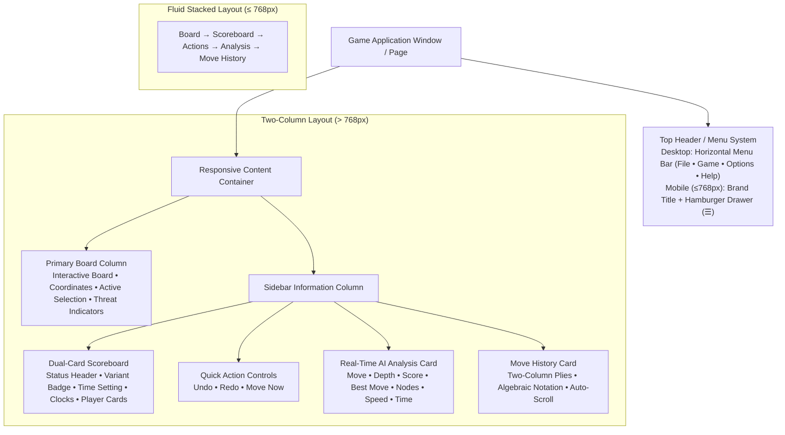
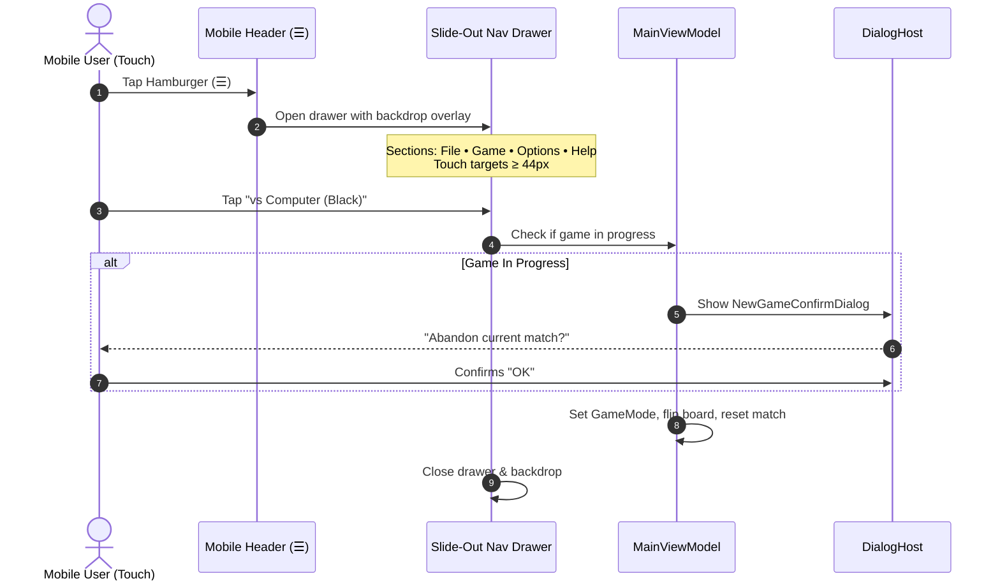
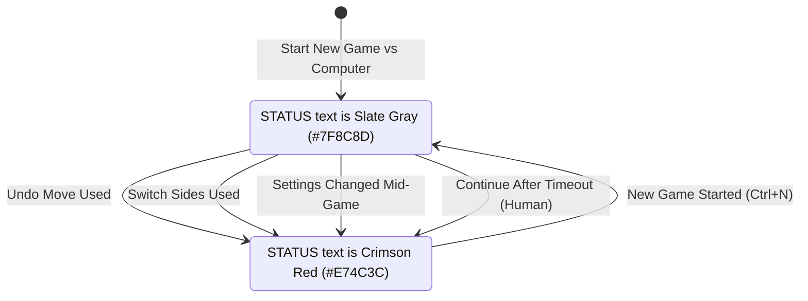
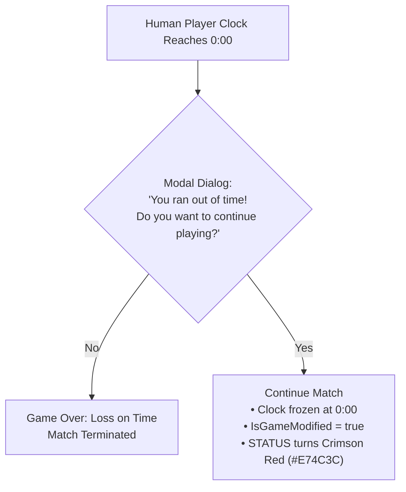

# General Game GUI Description & Engineering Blueprint

> **A Universal Implementation Specification and Architecture Checklist for Turn-Based 2-Player Board Games**  
> *Derived from Checkers .NET, Gomoku .NET, and Stello Architecture*

---

## 1. Executive Summary & Purpose

### 1.1 Objective
This document defines the **standard graphical user interface (GUI) architecture, visual layouts, state contracts, and component behaviors** for two-player turn-based board games (e.g., Checkers/Draughts, Gomoku/Renju, Chess, Reversi/Othello, Connect Four, Nine Men's Morris).

It is written specifically as an **engineering specification and checklist** for other game projects. By adhering to this specification, developers and AI engineering agents can build an identical, tournament-grade user experience across both **Web (Blazor WebAssembly / Single Page Application)** and **Desktop (WPF / WinUI / Avalonia)** platforms, customizing only game-specific rules, board dimensions, and custom settings options.

### 1.2 Core Design Principles
1. **Unified Dual-Platform Parity:** Core presentation logic resides in a shared MVVM ViewModel layer (`.App`), consumed identically by Web and Desktop frontends.
2. **Modern High-Contrast Light Theme:** Warm neutral parchment/wood styling, elevated white cards, soft ambient drop shadows, and high-readability slate typography.
3. **Responsive Adaptive Layout:** Persistent multi-column layout on desktop ($> 768\text{ px}$); fluid stacked layout with a mobile slide-out navigation drawer on narrow screens ($\le 768\text{ px}$).
4. **Zero-Lag Asynchronous AI Architecture:** Heavy engine search operations execute in isolated background threads (Web Workers in browser; background Tasks on desktop) with progress streaming and non-blocking cooperative yielding.
5. **Fair Play & Competitive Transparency:** Dynamic match integrity tracking (turning `"STATUS"` crimson red `#E74C3C` when game state has been altered) and interactive timeout continuation handling.

---

## 2. Master Layout & Visual Design System

### 2.1 Component Architecture Overview



### 2.2 Wireframe Layout

#### Desktop Multi-Column View ($> 768\text{ px}$)
```
┌────────────────────────────────────────────────────────────────────────────────────────────────────┐
│ File   Game   Options   Help                                                       [Desktop Menu]  │
├────────────────────────────────────────┬───────────────────────────────────────────────────────────┤
│                                        │ STATUS                [Variant Badge]         5 min / game│
│                                        ├───────────────────────────────────────────────────────────┤
│                                        │ White's Turn — Click a piece to move it                   │
│                                        │ ┌───────────────────────────┐ ┌─────────────────────────┐ │
│                                        │ │ ○ White              4:58 │ │ ● Black            5:00 │ │
│                                        │ │         Human             │ │        Computer         │ │
│                                        │ │          12               │ │           12            │ │
│                                        │ │       Kings: 0            │ │        Kings: 0         │ │
│                                        │ └───────────────────────────┘ └─────────────────────────┘ │
│                                        │ [   Undo   ]        [   Redo   ]        [ Move Now (Ctrl+M)]│
│                                        ├───────────────────────────────────────────────────────────┤
│                                        │ ANALYSIS                                                  │
│         INTERACTIVE GAME BOARD         │ Move:      6                     Nodes: 666,790           │
│                                        │ Depth:     9 plies               Speed: 345,666 nps       │
│        (e.g., 8x8 Checkers /           │ Score:     +34                   Time:  0:01.9            │
│         15x15 Gomoku / 8x8 Chess)      │ Best move: 18                                             │
│                                        ├───────────────────────────────────────────────────────────┤
│                                        │ MOVE HISTORY                                              │
│                                        │ #   White           Black                                 │
│                                        │ 1.  11-15           24-20                                 │
│                                        │ 2.  8-11            28-24                                 │
│                                        │ 3.  9-14            22-17 (active)                        │
└────────────────────────────────────────┴───────────────────────────────────────────────────────────┘
```

#### Mobile View ($\le 768\text{ px}$)
```
┌────────────────────────────────────────┐
│ ☰  Checkers .NET                       │  <-- Header with Brand Title & Hamburger Button
├────────────────────────────────────────┤
│                                        │
│         INTERACTIVE GAME BOARD         │  <-- Full-width responsive square board
│                                        │
├────────────────────────────────────────┤
│ STATUS       [Variant]     5 min / game│
│ White's Turn                           │
│ ┌──────────────────┐┌────────────────┐ │
│ │ ○ White     4:58 ││ ● Black   5:00 │ │
│ │ Human         12 ││ Computer    12 │ │
│ └──────────────────┘└────────────────┘ │
│ [  Undo  ]   [  Redo  ]   [ Move Now ] │
├────────────────────────────────────────┤
│ ANALYSIS                               │
│ Depth: 9 plies       Nodes: 666,790    │
│ Score: +34           Speed: 345,666 nps│
│ Best:  18            Time:  0:01.9     │
├────────────────────────────────────────┤
│ MOVE HISTORY                           │
│ 1. 11-15  24-20 | 2. 8-11  28-24       │
└────────────────────────────────────────┘
```

### 2.3 Master Color System & Design Tokens

Every implementing project should preserve these core color tokens to maintain visual consistency across games:

| Token Name | Hex Code | Purpose & Application |
|---|---|---|
| `--app-bg` | `#F4F1EA` / `#F5F7FA` | App background canvas (warm parchment / clean light gray) |
| `--card-bg` | `#FFFFFF` | Elevated surface for scoreboard, analysis panel, and move history |
| `--card-border` | `#E2E8F0` / `#CBD5E1` | Subtle $1\text{ px}$ borders with $8\text{ px}$ card border radius |
| `--text-primary` | `#2C3E50` / `#0F172A` | High-contrast dark slate text for headings and primary metrics |
| `--text-muted` | `#7F8C8D` / `#64748B` | Secondary text for labels, subtitles, and neutral status headers |
| `--active-turn` | `#3498DB` / `#3B82F6` | Sky-blue border, glowing ring, and turn indicator for active side |
| `--status-modified` | `#E74C3C` / `#DC2626` | Bold crimson red indicating modified game state (Undo/Switch/Timeout) |
| `--badge-variant` | `#16A085` / `#2C3E50` | Teal or deep slate pill badges for variant indicators |
| `--selection-glow` | `#F39C12` / `#F59E0B` | Warm amber highlight for selected pieces or source squares |
| `--target-dot` | `#2ECC71` / `#10B981` | Emerald green indicators for legal destination squares |
| `--btn-primary` | `#3498DB` | Primary action button background (e.g. "Move Now", modal OK) |
| `--btn-secondary` | `#ECF0F1` / `#F1F5F9` | Secondary button background (Undo, Redo, Cancel) |

---

## 3. Top Navigation & Menu System

The top navigation system exposes session lifecycle commands, opponent selection, settings, and documentation.

### 3.1 Standard 4-Menu Desktop Hierarchy

```
File                     Game                          Options              Help
├── New Game (Ctrl+N)    ├── vs Computer (White)       ├── Analysis (Ctrl+A)├── User guide (F1)
├── Open...  (Ctrl+O)    ├── vs Computer (Black)       ├── Sound            ├── Rules & Documentation (Shift+F1)
├── Save     (Ctrl+S)    ├── vs Human (Two players)    ├── Undo (Ctrl+Z)    └── About [Game]...
├── Save As...           ├─────────────────────────    └── Redo (Ctrl+Y)
└── Exit [Desktop only]  ├── Switch sides              └── [Custom Options]
                         ├─────────────────────────
                         └── Settings... (F2)
```

#### 1. File Menu
* **`New Game` (`Ctrl+N`):** Resets board to initial layout, wipes move history, clears undo/redo stacks, restores clocks to full time, clears modified game flags, and begins a fresh game.
* **`Open...` (`Ctrl+O`):** Prompts file picker to open a saved game record (`.pdn`, `.sgf`, `.pgn`, `.json`), parsing metadata and move history.
* **`Save` (`Ctrl+S`):** Saves the game directly to the current active file path (or triggers Save As if unsaved).
* **`Save As...`:** Prompts file save dialog to export standard match notation with full header tags (`[Event]`, `[Date]`, `[White]`, `[Black]`, `[Result]`, `[Variant]`).
* **`Exit`** *(Desktop WPF/WinUI only)*: Gracefully terminates the application window.

#### 2. Game Menu
* **`vs Computer (White)`:** Configures single-player mode where the **Human plays White/Player 1** (moving first from the bottom).
  * *Restart Safeguard:* If clicked while a match is currently in progress, a confirmation warning dialog prompts: *"Abandon current match and start a new game?"* with `OK` and `Cancel`.
* **`vs Computer (Black)`:** Configures single-player mode where the **Computer plays White/Player 1** (moving first) and the **Human plays Black/Player 2**. The board flips $180^\circ$ so Black is positioned at the bottom.
  * *Restart Safeguard:* Includes the identical confirmation warning prompt when a match is in progress.
* **`vs Human (Two players)`:** Enables local hot-seat multiplayer mode where two human players share the interface without computer calculation.
* *(Separator)*
* **`Switch sides`:** Allows the human player to swap sides with the computer mid-game during their turn without resetting the game state or move history.
  * *Enabling Preconditions:* Enabled **strictly** when: `IsVsComputer == true` AND `IsHumanTurn == true` AND `IsGameOver == false` AND `IsSearching == false`.
  * *Side Effect:* Immediately marks the game as modified (`IsGameModified = true`), triggering the crimson red `#E74C3C` `"STATUS"` header.
* *(Separator)*
* **`Settings...` (`F2`):** Opens the modal Game Settings dialog.

#### 3. Options Menu (or View + Options)
* **`Analysis` (`Ctrl+A`):** Toggles visibility of the real-time AI Search Analysis telemetry card.
* **`Sound`:** Toggles procedural audio feedback (piece selection, placement, captures, errors, game win/loss fanfare).
* **`Undo` (`Ctrl+Z`):** Steps backward. In `vs Computer` mode, rewinds two plies (both computer response and human move), refunds elapsed clock time, and sets `IsGameModified = true`.
* **`Redo` (`Ctrl+Y`):** Re-applies the next undone move from the redo stack.
* *Game-Specific Extension Slot:* Projects insert game-specific toggles here (e.g. `Coordinate Labels`, `Show Move Numbers`, `Ghost Preview`, `Threat Markers`).

#### 4. Help Menu
* **`User guide` (`F1`):** Navigates immediately to the graphical interface and control manual (`/docs/14-gui-and-settings` or local viewer).
* **`Rules & Documentation` (`Shift+F1`):** Navigates directly to the comprehensive engine architecture, game rules, and technical documentation.
* **`About [Game]...`:** Opens the modal About dialog containing author information, game summary, technical engine stack (.NET version, search algorithms, evaluation heuristics), and author portrait.

---

### 3.2 Responsive Mobile Drawer Navigation ($\le 768\text{ px}$)



---

## 4. Dual-Card Scoreboard & Dynamic Status Board

The scoreboard sits directly adjacent to or above the game board, presenting real-time game status, turn guidance, chess clocks, and player statistics.

### 4.1 Visual Structure & Layout

```
┌────────────────────────────────────────────────────────────────────────┐
│ STATUS              [Variant Badge]                       5 min / game │  <-- Header Row
├────────────────────────────────────────────────────────────────────────┤
│ White's Turn — Click a piece to move it                                │  <-- Turn Banner
│ ┌─────────────────────────────┐   ┌──────────────────────────────────┐ │
│ │ ○ White                4:58 │   │ ● Black                     5:00 │ │  <-- Card Layer 1
│ │          Human              │   │             Computer             │ │  <-- Card Layer 2
│ │           12                │   │                12                │ │  <-- Card Layer 3
│ │        Kings: 0             │   │             Kings: 0             │ │  <-- Card Layer 4
│ └─────────────────────────────┘   └──────────────────────────────────┘ │
│ [   Undo   ]             [   Redo   ]             [ Move Now (Ctrl+M)] │  <-- Quick Actions
└────────────────────────────────────────────────────────────────────────┘
```

### 4.2 Header Row & Status Badges
1. **Status Label (`STATUS`):**
   - **Default State:** Rendered in neutral muted slate (`#7F8C8D` / `#64748B`).
   - **Modified State:** When `IsVsComputer && IsGameModified` is true, changes to bold **Crimson Red (`#E74C3C`)**.
2. **Variant Badge (Center):**
   - Pill-shaped badge displaying the active rules variant (e.g., `[International]` in teal `#16A085`, `[English]` in navy `#2C3E50`, or `[Renju]` in amber `#D97706`).
3. **Computer Limit Badge (Right):**
   - When playing against the computer, displays the active engine thinking limit (e.g., `5 min / game`, `5s / move`, `8 plies`).
   - **Two-Player Behavior:** When playing `vs Human (Two players)`, this badge is automatically hidden.

### 4.3 Modified Game Specification (`#E74C3C`)

To guarantee competitive transparency, the game must track whether the human player has taken any action that compromises standard tournament conditions or provides an unfair advantage.



#### The Four Modification Triggers:
1. **Taking Back Moves (`Undo`):** The player reverts a move to explore an alternative or correct a blunder.
2. **Switching Sides (`Switch sides`):** The player takes over the computer's superior position mid-match.
3. **Mid-Game Settings Adjustment:** The player opens Settings and alters engine thinking time, depth, or opening book after moves have already been played.
4. **Continuing After Timeout:** The player runs out of clock time against the computer but elects to continue playing.

---

### 4.4 The 4-Layer Player Score Card Contract

```
┌───────────────────────────────────────────────┐
│ [Glyph] [Player Name]                 [Clock] │  <-- Layer 1: Identity & Time
│                    [Role]                     │  <-- Layer 2: Player Role Subtitle
│                   [Metric 1]                  │  <-- Layer 3: Primary Game Metric
│                   [Metric 2]                  │  <-- Layer 4: Secondary Game Metric
└───────────────────────────────────────────────┘
```

#### Layer-by-Layer Contract:
* **Layer 1 (Identity & Clock):**
  - **Color Glyph:** High-contrast circular swatch (`○` White / Ivory, `●` Black / Obsidian).
  - **Player Name:** `"White"` or `"Black"` (or custom player handle).
  - **Digital Clock:** Digital countdown formatted as `M:SS` (e.g., `4:58`). Visible only when a game time limit is active.
* **Layer 2 (Role Subtitle):**
  - In `vs Computer (White)`: White displays `"Human"`; Black displays `"Computer"`.
  - In `vs Computer (Black)`: White displays `"Computer"`; Black displays `"Human"`.
  - In `vs Human (Two players)`: White displays `"Player 1"`; Black displays `"Player 2"`.
* **Layer 3 (Primary Game Metric):**
  - Large prominent number representing primary material or progress (pieces remaining, stones placed, captures).
* **Layer 4 (Secondary Game Metric):**
  - Supplementary strategic attribute (kings count, threats, material delta).
* **Active Turn Visual:** Active player card receives `#3498DB` sky-blue border + elevated shadow + soft glow.

---

### 4.5 Chess Clocks & Timeout Continuation Flow



---

## 5. Quick Action Controls

Positioned immediately beneath the dual-card scoreboard:

| Action Button | Shortcut | Enabling Conditions | Execution Behavior |
|---|---|---|---|
| **`Undo`** | `Ctrl+Z` | `HistoryCount > 0` AND `!IsSearching` | In vs Computer, reverts 2 plies (both sides). In 2-player, reverts 1 ply. Refunds clock time. Marks game Modified. |
| **`Redo`** | `Ctrl+Y` | `RedoStackCount > 0` AND `!IsSearching` | Re-executes the next ply from the forward stack. |
| **`Move Now`** | `Ctrl+M` | **`IsSearching == true`** (Computer calculating) | Cancels the active background search token (`_cts.Cancel()`). Engine immediately plays best move from completed iteration. |

---

## 6. Real-Time AI Search Analysis Panel & Threading Contract

### 6.1 The 7 Telemetry Fields

| Field Name | Type / Format | Example Value | Description & Rules |
|---|---|---|---|
| **`Move`** | Integer / string | `6` or `#14` | The current game turn / ply number being calculated. |
| **`Depth`** | String | `9 plies` or `"Book"` | Current iterative deepening depth completed, or `"Book"` if playing from opening book. |
| **`Score`** | Formatted string | `+34`, `-120`, `+Win in 5` | Heuristic evaluation from computer's perspective in centipawns (`+` advantage, `-` disadvantage). |
| **`Best move`** | Algebraic notation | `18`, `H8`, `e2-e4` | Leading candidate move coordinate from the principal variation of the deepest completed iteration. |
| **`Nodes`** | Integer (N0) | `666,790` | Cumulative game tree positions evaluated during this search, with thousands separators. |
| **`Speed`** | String | `345,666 nps` | Nodes evaluated per second ($\text{nps} = \frac{\text{Nodes}}{\text{ElapsedSeconds}}$). |
| **`Time`** | String (`m:ss.f`) | `0:01.9` or `1.93s` | Elapsed wall-clock calculation duration for the active turn. |

---

## 7. Move History & Game Record Persistence

The move history panel gives players a permanent, readable transcript of the match:
* Two-column numbered table (White plies / Black plies).
* Active move row highlighted (`#EBF5FB`).
* Auto-scroll to latest move upon each move completion.
* Click-to-preview historical board states.
* Standard notation serialization (`.pdn`, `.sgf`, `.pgn`).

---

## 8. Game Settings Architecture & Extension Pattern

Accessed via **Game $\rightarrow$ Settings...** (`F2`), the modal settings dialog standardizes match configuration into sequential, collapsible cards.

```mermaid
graph TD
    SettingsDialog["Modal Settings Dialog"]
    SettingsDialog --> Sec1["1. Rules &amp; Game Variant<br/>Primary variant radio selection"]
    SettingsDialog --> Sec2["2. Computer Thinking Limits<br/>Fixed Depth • Time per Move • Time per Game"]
    SettingsDialog --> Sec3["3. Opening Book &amp; Transposition Table<br/>Opening Book Toggle (Dynamic Count) • Table Capacity (<select> or slider)"]
```



### 8.1 Section Breakdown

1. **Rule Variant Selection:** Radio group selecting the game variant (e.g., International vs English Checkers, Freestyle vs Renju Gomoku).
2. **Computer Thinking Limits (Three Standard Modes):**
   - **Fixed Depth ($1\dots 20$ plies):** Constant deterministic ply depth.
   - **Time per Move ($1\dots 60$ seconds):** Constant thinking time per turn with soft-limit safety margin ($\frac{2}{3}$).
   - **Time per Game ($1\dots 60$ minutes):** Total clock bank with dynamic move-time allocation based on game phase.
3. **Opening Book & Transposition Table:**
   - **Opening Book Checkbox:** Dynamically displays the canonical position count for the active variant (e.g. `Checkers Opening Book (26,367 positions)` for International, `(32,369 positions)` for English). Checking/unchecking enables or disables querying opening book databases before running tree search.
   - **Transposition Table Capacity:** In Blazor Web, rendered as a styled `<select>` dropdown (`1,048,576 entries (16 MB) - Default` up to `16,777,216 entries (256 MB)`). In WPF Desktop, rendered with a responsive slider and tabular entry text.

---

## 9. Keyboard Shortcuts Master Map

| Key Binding | Scope | Action Description |
|---|---|---|
| **`Ctrl+N`** | Global | Start a New Game (with confirmation safeguard if in-progress) |
| **`Ctrl+O`** | Global | Open saved game record file |
| **`Ctrl+S`** | Global | Save current match record |
| **`Ctrl+Z`** | Board | **Undo** last move (2 plies vs computer; refunds clock time) |
| **`Ctrl+Y`** | Board | **Redo** previously undone move |
| **`Ctrl+A`** | Global | Toggle **AI Analysis Panel** visibility |
| **`Ctrl+M`** | Engine | **Move Now:** Cancel AI search and force immediate move |
| **`F1`** | Global | Open **User guide** documentation chapter |
| **`Shift+F1`** | Global | Open **Rules & Architectural manual** |
| **`F2`** | Global | Open **Game Settings** dialog |
| **`Escape`** | Modal | Close active modal dialog or mobile drawer |

---

## 10. Cross-Project Source Reference Map

| Project | File Reference | Description |
|---|---|---|
| **Checkers** | [`SettingsViewModel.cs`](file:///c:/Udvikling/Spil/Checkers/src/Checkers.App/ViewModels/SettingsViewModel.cs) | Backing properties for dynamic book description, thinking limits, variant, and TT power |
| **Checkers** | [`DialogHost.razor`](file:///c:/Udvikling/Spil/Checkers/src/Checkers.Web/Components/DialogHost.razor) | Web dialog implementing opening book toggle & TT `<select>` dropdown |
| **Checkers** | [`SettingsWindow.xaml`](file:///c:/Udvikling/Spil/Checkers/src/Checkers.Wpf/Views/SettingsWindow.xaml) | WPF desktop settings window with combined Book & TT group |
| **Gomoku** | `C:\Udvikling\Spil\Gomoku\src\Gomoku.Web\Components\DialogHost.razor` | Reference implementation of Carbon Opening Book & Transposition Table group |
| **Stello** | `C:\Udvikling\Spil\Stello\Stello.Net\Stello.Web\Components\DialogHost.razor` | Reference implementation of Stello Opening Book & Transposition Table group |

